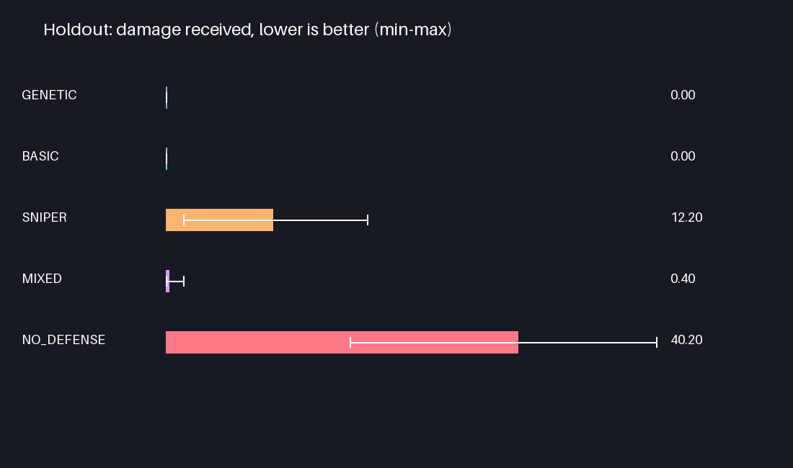
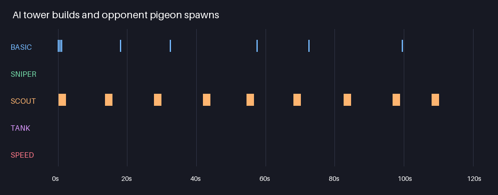
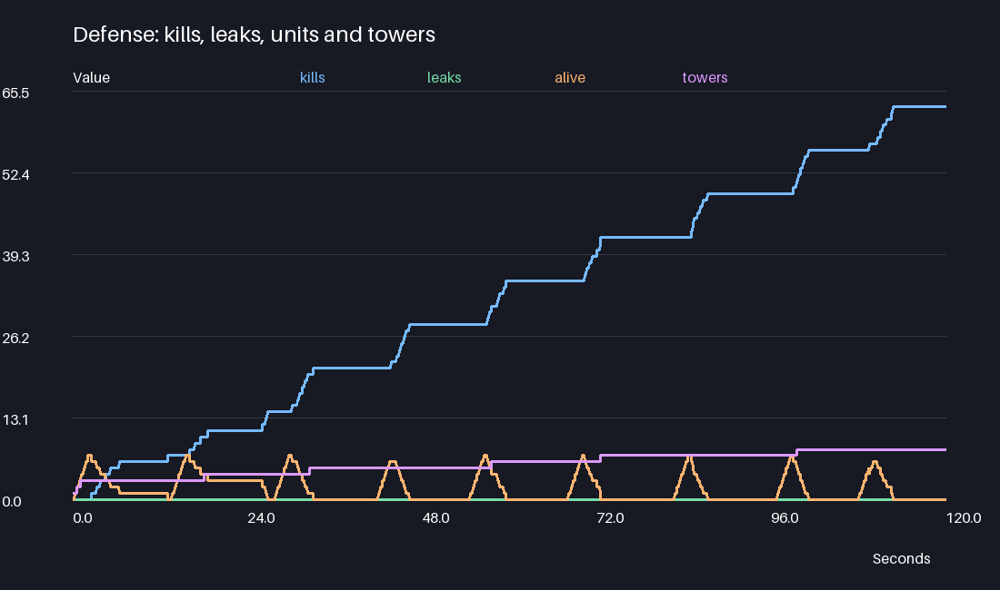
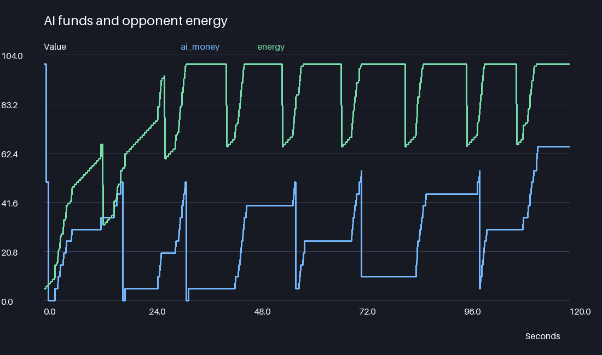
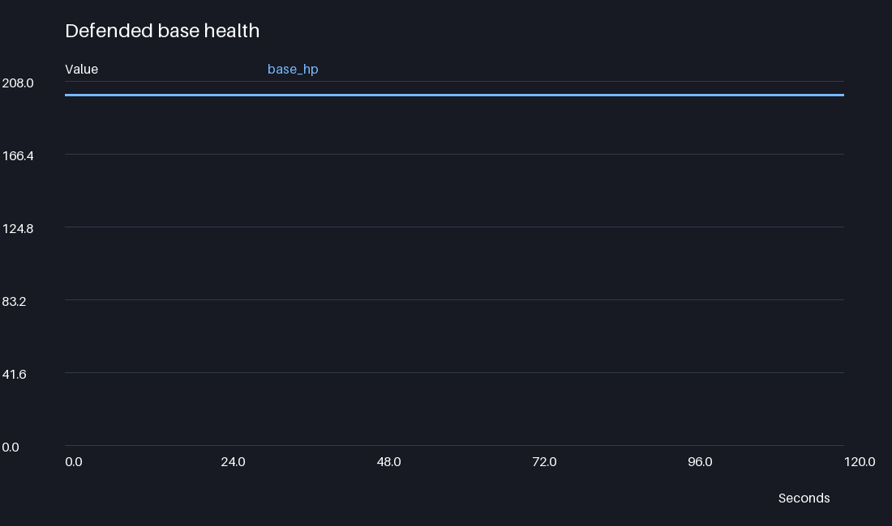
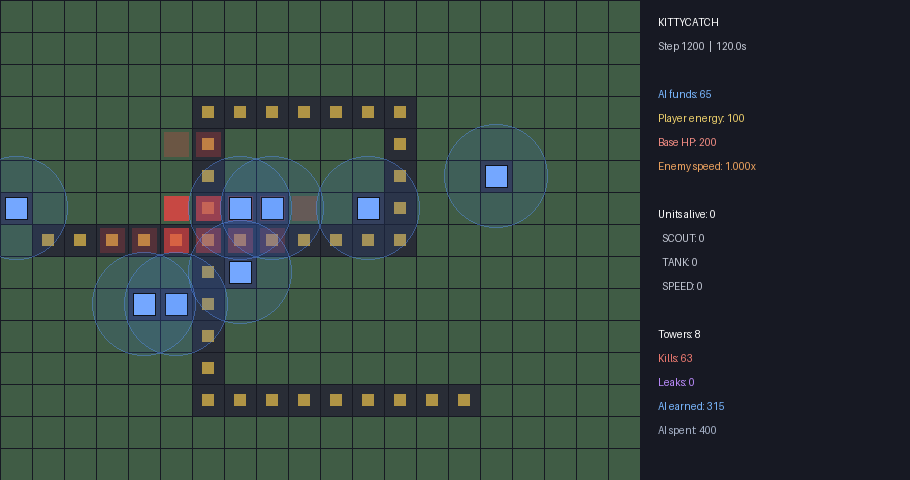

# Sprawozdanie: nowe układy obrony KittyCatch

## Role i cel eksperymentu

**AI broni bazy: wybiera typ, miejsce i czas budowy wież. Gołębie wysyła przeciwnik.** Jedyną akcją modelu jest `build_tower`, zgodna z istniejącym socketem Godota. Badanie dotyczy limitu energii 100, bazy 200 HP i epizodów długości 120 s.

Cel: minimalizacja obrażeń otrzymanych przez bazę. Fitness = −liczba przecieków + 0,1 × zabite / max(faktycznie wysłane gołębie, 1). Wyższy fitness jest lepszy; na wykresie porównawczym niższe obrażenia są lepsze. Premia za zabicia rozstrzyga remisy. Podstawowym kryterium selekcji jest średnia fitness po ziarnach treningowych.

## Wyniki na oddzielnych scenariuszach testowych

| Strategia obrony | Śr. obrażenia ↓ | Odchylenie | Min–maks | Śr. zabicia | Śr. wieże |
| --- | --- | --- | --- | --- | --- |
| GENETIC | 0.00 | 0.00 | 0–0 | 46.0 | 8.6 |
| BASIC | 0.00 | 0.00 | 0–0 | 45.8 | 9.4 |
| SNIPER | 12.20 | 9.11 | 2–23 | 32.4 | 4.2 |
| MIXED | 0.40 | 0.80 | 0–2 | 44.8 | 7.6 |
| NO_DEFENSE | 40.20 | 11.34 | 21–56 | 0.0 | 0.0 |

GENETIC: zwycięzca treningu. BASIC / SNIPER / MIXED: heurystyki pokrycia trasy, odpowiednio jeden typ lub typy naprzemienne; wszystkie mają tyle samo slotów budowy. NO_DEFENSE: kontrola bez wież. Chromosom nie jest wybierany na podstawie testu.

GA_z: zwycięzca niezależnego przebiegu o ziarnie z. PREVIOUS: poprzedni chromosom ponownie oceniony na aktualnym balansie i tych samych scenariuszach, z zachowaniem jego zapisanych czasów budowy. Nie mieszamy historycznych wyników uzyskanych przy innych zasadach z aktualnym testem.



## Parametry treningu

| Parametr | Wartość |
| --- | --- |
| population | 32 |
| generations | 30 |
| slots | 10 |
| duration | 120.0 |
| dt | 0.1 |
| seed | 42 |
| search_seeds | None |
| mutation_rate | 0.15 |
| train_seeds | [10, 11, 12, 13, 14] |
| test_seeds | [310, 311, 312, 313, 314] |

Selekcja turniejowa: 3 osobniki. Krzyżowanie: niezależnie każdy gen od jednego z rodziców (50/50). Mutacja: szum Gaussa σ=0,15 i obcięcie do [0,1]. Elitaryzm: max(1, populacja // 8). Populacja początkowa zawiera heurystyki pokrycia trasy. Losowe plany zaczynają od czasów w pierwszych 20% epizodu. Remisy fitness wewnątrz populacji rozstrzyga losowanie kontrolowane ziarnem przebiegu, co pozwala zachować różne równie skuteczne układy.

Identyfikator konfiguracji SHA-256: d9f8324878a66f907d4ad596921f12ff8e38a056fc8cfa2545039b3bd4bd6c8a.

Ten raport jest ponowną oceną zapisanej strategii; nie uruchomiono nowego treningu. Parametry populacji i pokoleń w argumentach nie opisują pochodzenia zapisanego chromosomu.

## Chromosom i jego interpretacja

Chromosom ma **40 genów**, czyli **10 slotów budowy**. Każda czwórka to `[typ, x, y, najwcześniejszy_czas]`. Kolejność typów: BASIC, SNIPER. Slot nie jest gwarancją zbudowania wieży: potrzeba środków, wolnego pola i potwierdzenia poprzedniej komendy.

Typ = min(liczba_typów − 1, int(gen × liczba_typów)). x = round(gen × (szerokość − 1)), y = round(gen × (wysokość − 1)). Najwcześniejszy czas = gen × limit epizodu. Sloty są przeglądane według czasu, potem indeksu. Jeśli wybrane pole jest niedostępne, model wybiera najbliższe aktualnie wolne pole budowy według odległości kwadratowej; remisy rozstrzyga (x,y). Nie blokuje tańszych gotowych slotów, gdy na droższy brakuje pieniędzy.

```json
{
  "tower_types": [
    "BASIC",
    "SNIPER"
  ],
  "genes": [
    0.3660466892466353,
    0.4060885594470181,
    0.4672722989742278,
    0,
    0.25,
    0.5670825160987344,
    0.3968448355249508,
    0.1245176666017033,
    0.25,
    0.3684210526315789,
    0.4752371988487987,
    0,
    0.20173969606165632,
    0.8127469847357791,
    0.3517357559469759,
    0.3577608610526481,
    0,
    0.25723652434563526,
    0.6714760351460928,
    0.06736555059212705,
    0,
    0.34376091759369043,
    0.4987231655647726,
    0,
    0.48664089403938426,
    0,
    0.42857142857142855,
    0.10914046312349214,
    0.09125448227713565,
    0.2588697254505471,
    0.6586592737355402,
    0.3138857762657292,
    0.8553430794530262,
    0.7835186956476787,
    0.8239509478925124,
    0.05467985644706067,
    0.5116254552958417,
    0.4996396797854388,
    0.2506099728537752,
    0.197564947265645
  ],
  "duration": 120.0,
  "role": "tower_defense"
}
```

### Odkodowany plan budowy (przed korektą zajętych pól)

| Slot (od 0) | Indeksy genów | Typ | Cel x | Cel y | Najwcześniej [s] |
| --- | --- | --- | --- | --- | --- |
| 0 | 0–3 | BASIC | 8 | 7 | 0.000 |
| 2 | 8–11 | BASIC | 7 | 7 | 0.000 |
| 5 | 20–23 | BASIC | 7 | 7 | 0.000 |
| 8 | 32–35 | SNIPER | 15 | 12 | 6.562 |
| 4 | 16–19 | BASIC | 5 | 9 | 8.084 |
| 6 | 24–27 | BASIC | 0 | 6 | 13.097 |
| 1 | 4–7 | BASIC | 11 | 6 | 14.942 |
| 9 | 36–39 | SNIPER | 9 | 4 | 23.708 |
| 7 | 28–31 | BASIC | 5 | 9 | 37.666 |
| 3 | 12–15 | BASIC | 15 | 5 | 42.931 |

## Ustawienia przeciwnika: fale gołębi

Scenariusz = ziarno + profil. Profil wybierany przez seed modulo 5: 0: SCOUT, 1: TANK, 2: SPEED, 3: MIXED, 4: BURST. SCOUT/TANK/SPEED używają jednego typu, MIXED i BURST losują skład. Budżet żądanej fali to 35 energii, a BURST 65, ograniczony maksimum energii gracza. Planowany start pierwszej fali: 0 s. Następne odstępy: losowo 11–16 s, BURST 20–26 s.

Harmonogram żądań generowany jest przed epizodem, niezależnie od chromosomu. Koszty i regeneracja obowiązują normalnie: jeśli brakuje energii lub kolejka trwa, przeciwnik czeka. Zabicia zwracają energię graczowi, więc rzeczywiste czasy i liczba wysłanych fal mogą różnić się między strategiami. Nie traktujemy takich przebiegów jako identycznych fal w identycznym czasie.

| Seed | Profil | Obrażenia ↓ | HP bazy | Zabicia | Wysłane | Wieże | Wydatek AI | Odrzucone |
| --- | --- | --- | --- | --- | --- | --- | --- | --- |
| 310 | SCOUT | 0 | 200 | 63 | 63 | 8 | 400 | 0 |
| 311 | TANK | 0 | 200 | 27 | 27 | 8 | 400 | 0 |
| 312 | SPEED | 0 | 200 | 45 | 45 | 9 | 480 | 0 |
| 313 | MIXED | 0 | 200 | 43 | 43 | 9 | 480 | 0 |
| 314 | BURST | 0 | 200 | 52 | 53 | 9 | 480 | 0 |

## Balans gry i ekonomia

| Wieża | Koszt | Zasięg w JSON | Zasięg fizyczny [kafle] | Obrażenia | Ataki/s |
| --- | --- | --- | --- | --- | --- |
| BASIC | 50 | 2.0 | 0.80 | 9 | 1.25 |
| SNIPER | 80 | 4.5 | 1.80 | 12 | 0.25 |

| Gołąb | HP | Szybkość [kafle/s] | Koszt energii | Nagroda dla AI |
| --- | --- | --- | --- | --- |
| SCOUT | 10 | 1.0 | 5 | 5 |
| TANK | 30 | 0.8 | 10 | 12 |
| SPEED | 15 | 1.4 | 7 | 8 |

```json
{
  "economy": {
    "player": {
      "starting_energy": 40,
      "max_energy": 100,
      "energy_regen_per_second": 2.0,
      "kill_energy_refund_fraction": 1.0
    },
    "ai": {
      "starting_money": 150
    }
  },
  "combat": {
    "tower_range_scale": 0.4,
    "enemy_hit_radius_px": 8.0,
    "enemy_path_spread_px": 8.0,
    "enemy_speed_bonus_per_base_hit": 0.005,
    "max_enemy_speed_bonus": 0.1
  },
  "base": {
    "health": 200
  },
  "map": {
    "tile_size_px": 64,
    "cell_size_px": 32,
    "width_tiles": 20,
    "height_tiles": 15
  }
}
```

Zdrowie startowe bazy: 200. Każdy przeciek zadaje 1 obrażenie. Wieże finansowane są z funduszy AI oraz nagród za zabicia. Energia służy wyłącznie przeciwnikowi do wysyłania gołębi. Zwrot przy dotarciu do celu: ceil(koszt/2).

## Jedna rozgrywka zwycięskiej obrony

Seed **310**, profil **SCOUT**. Wybrany jawnie lub jako pierwszy z listy testowej; nie wybieramy najlepszego testu do animacji. Czas: 120.0 s. Baza: **200 HP**, przecieki: **0**, zabicia: **63**, wieże AI: **8**.

### Faktyczne budowy wież przez AI

| Czas [s] | Slot | Typ | x | y | Koszt |
| --- | --- | --- | --- | --- | --- |
| 0.0 | 0 | BASIC | 8 | 6 | 50 |
| 0.5 | 2 | BASIC | 7 | 6 | 50 |
| 1.0 | 5 | BASIC | 7 | 8 | 50 |
| 18.0 | 4 | BASIC | 5 | 9 | 50 |
| 32.5 | 6 | BASIC | 0 | 6 | 50 |
| 57.5 | 1 | BASIC | 11 | 6 | 50 |
| 72.5 | 7 | BASIC | 4 | 9 | 50 |
| 99.5 | 3 | BASIC | 15 | 5 | 50 |

Niewykonane sloty: 8, 9. Mogły oczekiwać na pieniądze, najwcześniejszy czas lub wolne pole do końca epizodu.

### Fale przeciwnika: planowane i rzeczywiste czasy

| Fala | Plan [s] | Start [s] | SCOUT | TANK | SPEED | Koszt energii |
| --- | --- | --- | --- | --- | --- | --- |
| 1 | 0.0 | 0.0 | 7 | 0 | 0 | 35 |
| 2 | 13.4 | 13.4 | 7 | 0 | 0 | 35 |
| 3 | 27.6 | 27.6 | 7 | 0 | 0 | 35 |
| 4 | 41.7 | 41.7 | 7 | 0 | 0 | 35 |
| 5 | 54.4 | 54.4 | 7 | 0 | 0 | 35 |
| 6 | 67.8 | 67.9 | 7 | 0 | 0 | 35 |
| 7 | 82.5 | 82.5 | 7 | 0 | 0 | 35 |
| 8 | 96.5 | 96.6 | 7 | 0 | 0 | 35 |
| 9 | 107.9 | 107.9 | 7 | 0 | 0 | 35 |

### Bilans gołębi według typu

| Typ | Wysłane | Zabite | Dotarły do bazy | Na trasie | W kolejce |
| --- | --- | --- | --- | --- | --- |
| SCOUT | 63 | 63 | 0 | 0 | 0 |
| TANK | 0 | 0 | 0 | 0 | 0 |
| SPEED | 0 | 0 | 0 | 0 | 0 |











## Uruchomienie AI przez socket Godota

Z katalogu python_ai uruchom serwer, następnie otwórz godot_game/project.godot i uruchom grę (F6/F5 zgodnie z projektem):

```powershell
python -m src.serwer --strategy training_results/demo_check/best_strategy.json --host 127.0.0.1 --port 8080
```

Godot jest klientem TCP. Python odbiera init i update, odsyła JSON UTF-8 zakończony znakiem nowej linii. Przykład akcji:

```json
{"action":"build_tower","command_id":"ga-episode-step-seq-s0","tower_type":"BASIC","x":3,"y":3}
```

Model nie wysyła fal. Kontroluje budżet i wolne pola w aktualnej obserwacji. Wysyła maksymalnie jedną komendę na 0,5 s i czeka na action_result. Powtórzone lub starsze update nie generują kolejnych komend; init nowego epizodu resetuje plan. Po 2 s bez potwierdzenia sprawdza zajętość pola i rozstrzyga, czy ponowić slot. Sam Godot ostatecznie zatwierdza koszt, typ i położenie wieży.

## Pliki, odtwarzalność i ograniczenia

- [Chromosom obrony](best_strategy.json)
- [Dane eksperymentu](report.json), [pełne przebiegi, zdarzenia i plan](detailed_report.json)
- [Budowy wszystkich testów](builds.csv), [fale przeciwnika](waves.csv), [pojawienia się gołębi](spawns.csv)
- [Porównanie](comparison.csv), [przebieg wybranej gry](replay.csv)

```powershell
python -m src.experiment_report --input training_results/demo_check/report.json --gif --replay-seed 310
python -m src.pdf_report --input training_results/demo_check/report.md
```

Wyniki dotyczą jednej mapy, zapisanej konfiguracji i badanych profili gołębi. Algorytm wybiera najlepszy sprawdzony plan, bez dowodu globalnego optimum. Limit slotów ogranicza liczbę wież. Wynik lokalnej symulacji nie jest wynikiem meczu w Godocie; fizyka, dyskretny krok i opóźnienia sieci mogą zmienić rezultat. Integracja socketu jest testowana protokołem; rzeczywisty mecz wymaga uruchomionego Godota.
