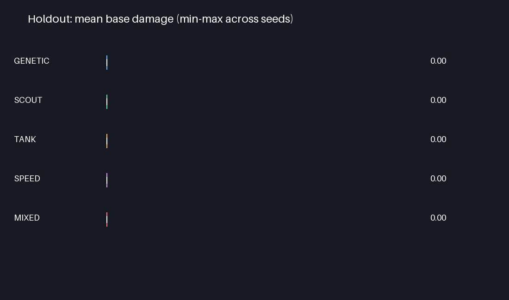
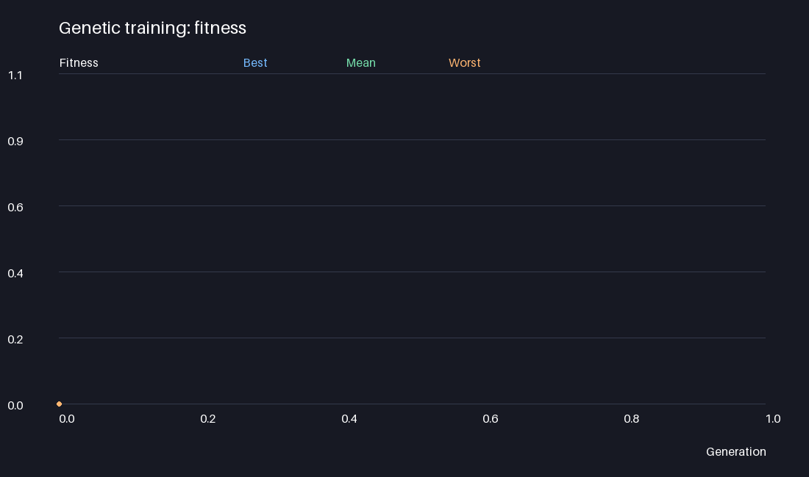
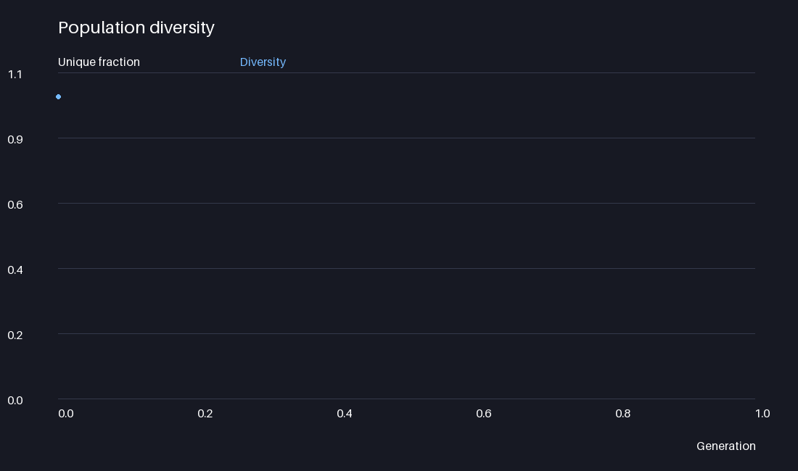
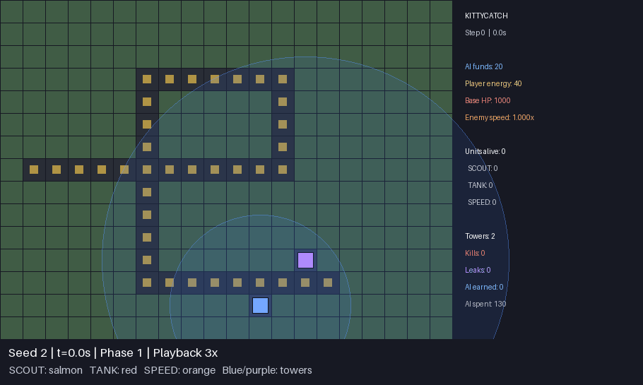
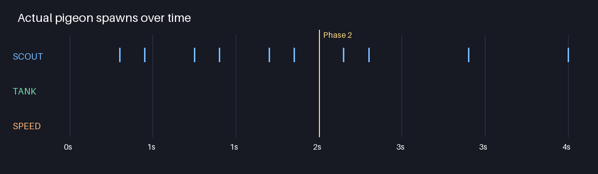
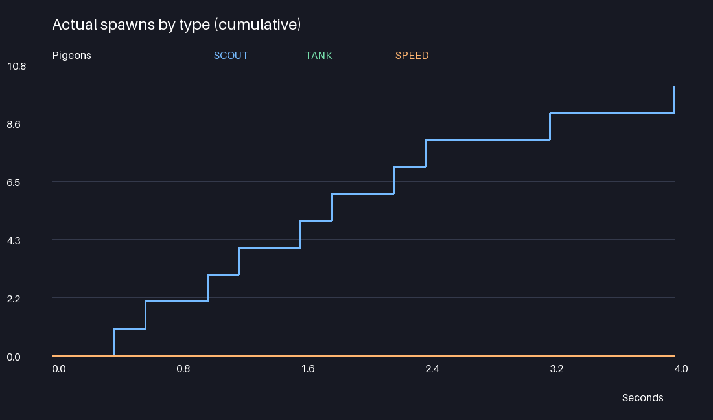
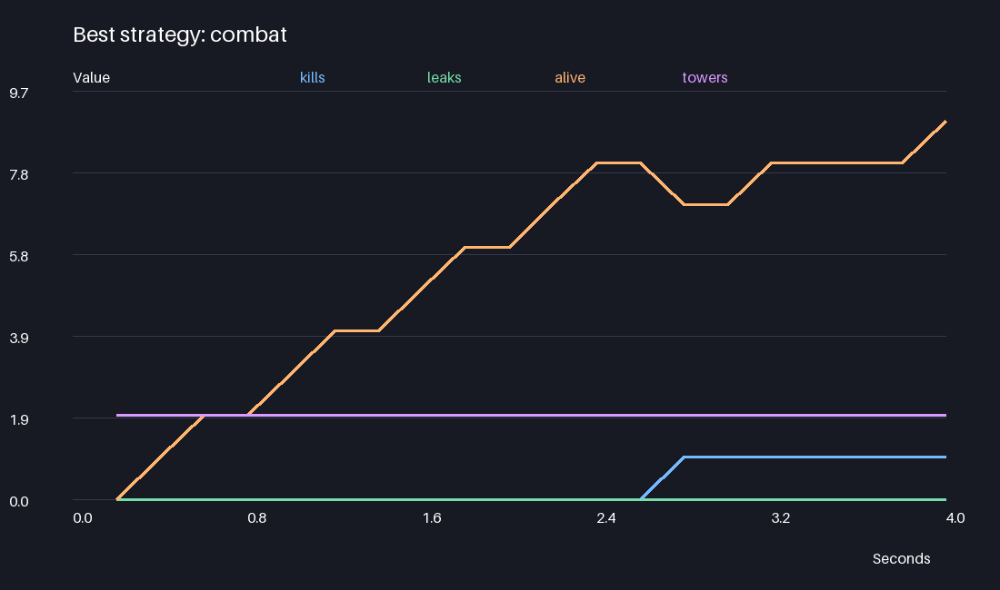
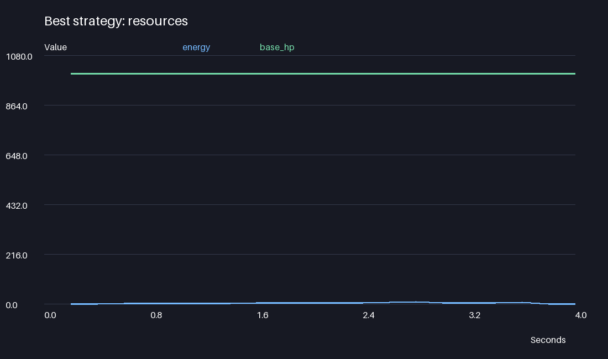
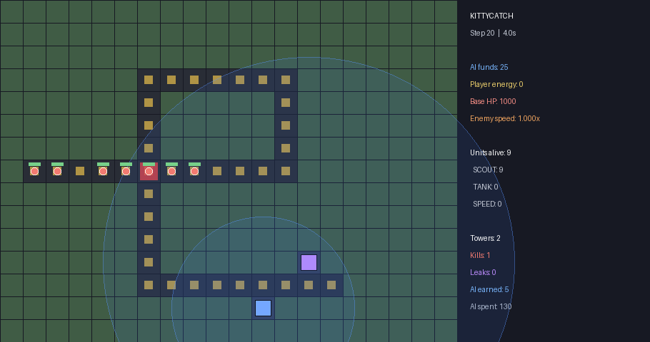

# Kompletny raport strategii wysyłania gołębi

## Wynik i zakres eksperymentu

Najlepsza strategia oznacza zwycięzcę przeprowadzonego treningu. Algorytm nie dowodzi globalnego optimum. Wyniki pochodzą z lokalnego symulatora, nie z uruchomienia Godota.

| Strategia | Średnie obrażenia | Odchylenie standardowe | Min–maks |
| --- | --- | --- | --- |
| GENETIC | 0.00 | 0.00 | 0–0 |
| SCOUT | 0.00 | 0.00 | 0–0 |
| TANK | 0.00 | 0.00 | 0–0 |
| SPEED | 0.00 | 0.00 | 0–0 |
| MIXED | 0.00 | 0.00 | 0–0 |



## Parametry treningu

| Parametr | Wartość |
| --- | --- |
| population | 4 |
| generations | 1 |
| duration | 4.0 |
| dt | 0.2 |
| seed | 42 |
| mutation_rate | 0.15 |
| train_seeds | [1] |
| test_seeds | [2] |

Selekcja: turniej 3 osobników. Krzyżowanie: niezależny wybór genu jednego z rodziców (50/50). Mutacja: szum Gaussa σ=0,2, ograniczenie do [0,1]. Elitaryzm: max(1, populacja // 8). Osobniki oceniane są na tych samych ziarnach treningowych; wyniki testowe nie wybierają chromosomu.

Fitness = obrażenia bazy + 0,5 × (1 − czas / limit), wyłącznie gdy baza zostanie zniszczona. W pozostałych przypadkach fitness to same obrażenia. Maksymalizowana jest średnia po scenariuszach treningowych. Gołębie w kolejce i na trasie po limicie nie otrzymują punktów.

Najlepszy fitness treningowy: 0.00 → 0.00.





## Chromosom zwycięzcy

```json
{
  "unit_types": [
    "SCOUT",
    "TANK",
    "SPEED"
  ],
  "genes": [
    1.0,
    0.0,
    0.0,
    0,
    1,
    0,
    1.0,
    0.0,
    0.0,
    0,
    1,
    0
  ]
}
```

Chromosom ma 12 genów. Kolejność w każdej fazie: wagi SCOUT, TANK, SPEED, próg energii, ułamek wydatku, odstęp między startami fal. Wszystkie geny należą do [0,1]. Faza 2 zaczyna się w połowie limitu czasu; nie przerywa już rozpoczętej fali.

| Gen (indeks od 0) | Znaczenie | Faza 1 | Faza 2 |
| --- | --- | --- | --- |
| 0 / 6 | SCOUT | 1.000000000 | 1.000000000 |
| 1 / 7 | TANK | 0.000000000 | 0.000000000 |
| 2 / 8 | SPEED | 0.000000000 | 0.000000000 |
| 3 / 9 | Próg energii | 0.000000000 | 0.000000000 |
| 4 / 10 | Wydatek | 1.000000000 | 1.000000000 |
| 5 / 11 | Odstęp | 0.000000000 | 0.000000000 |

| Faza | Czas [s] | Wagi typów | Próg energii | Wydatek energii | Odstęp [s] |
| --- | --- | --- | --- | --- | --- |
| 1 | 0–2 | SCOUT: 1.0000, TANK: 0.0000, SPEED: 0.0000 | 5 | 100.00% | 0.0000 |
| 2 | 2–4 | SCOUT: 1.0000, TANK: 0.0000, SPEED: 0.0000 | 5 | 100.00% | 0.0000 |

Próg = min(maksimum energii, max(koszt najtańszego typu, round(gen × maksimum))). Budżet = min(energia, max(koszt najtańszego typu, int(energia × (0,15 + 0,85 × gen)))). Odstęp = 12 × gen sekund od poprzedniego startu. Dodatkowo trzeba poczekać na opróżnienie kolejki.

Wagi nie są gwarantowanymi procentami składu. Kolejna jednostka maksymalizuje waga / (liczba już wybranych + 1) spośród typów mieszczących się w pozostałym budżecie. Waga zero wyklucza typ. Mała dodatnia waga może nie dać żadnej jednostki przy małych falach. Kolejność wybranych jednostek jest następnie tasowana.

## Ustawienia jednostek, obrony i ekonomii

| Typ gołębia | HP | Szybkość [kafle/s] | Koszt energii | Nagroda obrony |
| --- | --- | --- | --- | --- |
| SCOUT | 10 | 1.0 | 5 | 5 |
| TANK | 20 | 0.8 | 10 | 12 |
| SPEED | 15 | 1.2 | 7 | 8 |

| Wieża | Koszt | Zasięg [kafle] | Obrażenia | Ataki/s |
| --- | --- | --- | --- | --- |
| BASIC | 50 | 2.0 | 9 | 1.25 |
| SNIPER | 80 | 4.5 | 12 | 0.25 |

Pełna konfiguracja użyta w eksperymencie:

```json
{
  "economy": {
    "player": {
      "starting_energy": 40,
      "max_energy": 100,
      "energy_regen_per_second": 2.0,
      "kill_energy_refund_fraction": 0.6
    },
    "ai": {
      "starting_money": 150
    }
  },
  "combat": {
    "enemy_speed_bonus_per_base_hit": 0.005,
    "max_enemy_speed_bonus": 0.1
  },
  "map": {
    "tile_size_px": 64,
    "cell_size_px": 32,
    "width_tiles": 20,
    "height_tiles": 15
  }
}
```

Zdrowie startowe bazy: 1000. Każdy gołąb docierający do bazy zabiera 1 HP, niezależnie od typu. Wysyłanie jednostek: co 0,3 s, z kwantyzacją do kroku symulacji. Przy domyślnym dt=0,2 s rzeczywiste odstępy mogą wynosić 0,2 lub 0,4 s.

Obrońca sortuje pola budowy według odległości od trasy (41 próbek) plus losowy składnik jednostajny 0–2,5 komórki. Typy wież tasuje raz na scenariusz, potem buduje cyklicznie. Stawia wieże od razu i kontroluje środki co około 1 s; reinwestuje nagrody za zabicia. Jeśli nie stać go na następny typ, czeka. Ziarno określa rozmieszczenie, kolejność typów wież i tasowanie fal. Wspólne ziarno nie gwarantuje identycznych późniejszych wież, bo strategie dają różne nagrody za zabicia.

## Wyniki każdego scenariusza testowego

| Seed | Obrażenia | Zabite | Zamówione | Energia wydana | Obrażenia/energia | Wieże | Kolejność wież |
| --- | --- | --- | --- | --- | --- | --- | --- |
| 2 | 0 | 1 | 10 | 50 | 0.0000 | 2 | SNIPER → BASIC |

## Jedna pełna rozgrywka

Pokazany seed: **2**, wskazany jawnie lub pierwszy z listy testowej. Nie wybieramy do animacji najlepszego wyniku testowego. Czas: 4.0 s; obrażenia: 0; zabicia: 1; HP bazy na końcu: 1000.



Animacja: 9 klatek, próbki co około 0,5 s czasu symulacji, odtwarzanie 3× (poza pauzą na końcu). Końcowa klatka odpowiada dokładnie końcowemu stanowi symulacji.

### Typy gołębi w kolejnych fazach

| Faza | Typ | Zamówione na starcie fal | Faktycznie wysłane w tej fazie |
| --- | --- | --- | --- |
| 1 | SCOUT | 8 | 6 |
| 1 | TANK | 0 | 0 |
| 1 | SPEED | 0 | 0 |
| 2 | SCOUT | 2 | 4 |
| 2 | TANK | 0 | 0 |
| 2 | SPEED | 0 | 0 |

Faza zamówienia może różnić się od fazy faktycznego wysłania, jeśli kolejka przekracza granicę faz. Niewykorzystane typy pozostają jawnie pokazane z wartością zero.





### Bilans jednostek po zakończeniu

| Typ | Zamówione | Wysłane | Zabite | Dotarły do bazy | Na trasie | W kolejce |
| --- | --- | --- | --- | --- | --- | --- |
| SCOUT | 10 | 10 | 1 | 0 | 9 | 0 |
| TANK | 0 | 0 | 0 | 0 | 0 | 0 |
| SPEED | 0 | 0 | 0 | 0 | 0 | 0 |

### Harmonogram wszystkich fal

| Fala | Start [s] | Faza | SCOUT | TANK | SPEED | Koszt | Energia przed → po |
| --- | --- | --- | --- | --- | --- | --- | --- |
| 1 | 0.0 | 1 | 8 | 0 | 0 | 40 | 40 → 0 |
| 2 | 2.8 | 2 | 1 | 0 | 0 | 5 | 8 → 3 |
| 3 | 3.6 | 2 | 1 | 0 | 0 | 5 | 5 → 0 |

Dokładna kolejność jednostek po tasowaniu: [waves.csv](waves.csv). Rzeczywisty czas pojawienia się każdego gołębia: [spawns.csv](spawns.csv).

### Wszystkie budowy wież w pokazanej rozgrywce

| Czas [s] | Typ | x | y | Koszt |
| --- | --- | --- | --- | --- |
| 0.0 | SNIPER | 13 | 11 | 80 |
| 0.0 | BASIC | 11 | 13 | 50 |

Współrzędne komórek od zera; siatka x-major. [Budowy wież we wszystkich scenariuszach](defense_builds.csv).







## Pliki i odtwarzalność

- [Chromosom](best_strategy.json)
- [Pełne dane raportu, fazy, zdarzenia, obrona i przebiegi testowe](detailed_report.json)
- [Oryginalne dane eksperymentu](report.json)
- [Dane treningu](generations.csv), [porównanie](comparison.csv), [przebieg](replay.csv)

Ponowne wygenerowanie raportu i GIF-a z zapisanej konfiguracji eksperymentu:

```powershell
python -m src.experiment_report --input training_results/integration_check/report.json --gif --replay-seed 2
```

Ograniczenia: jedna mapa, jeden model obrońcy, skończona liczba ziaren, dwie fazy strategii oraz przybliżona fizyka i czas walki. Brak punktów za gołębie nadal na trasie oznacza, że wynik zależy od limitu czasu. Nie przeprowadzono oceny przeciwko wszystkim możliwym ustawieniom przeciwnika.
