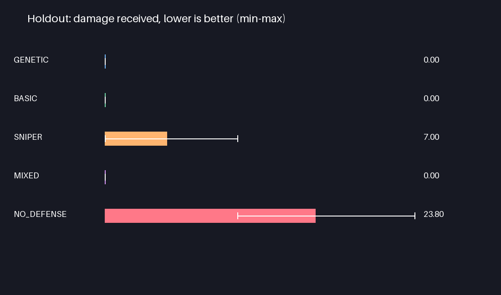
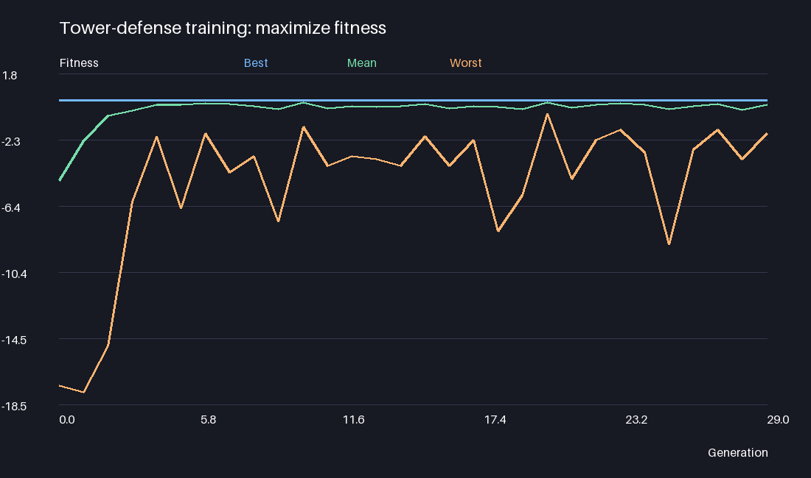
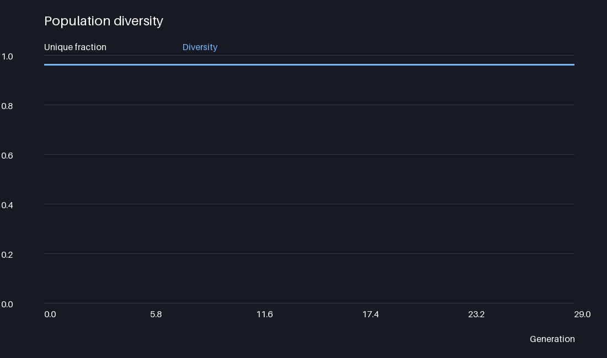
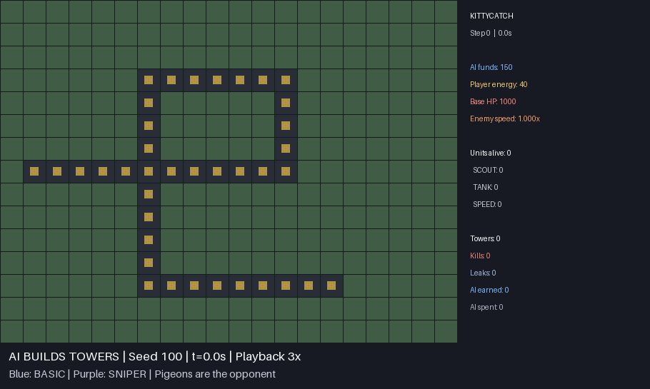
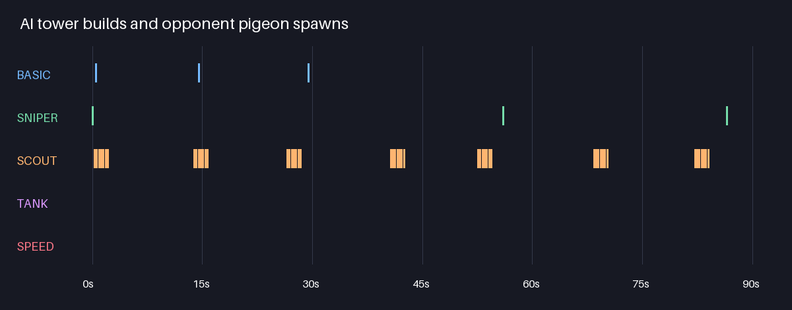
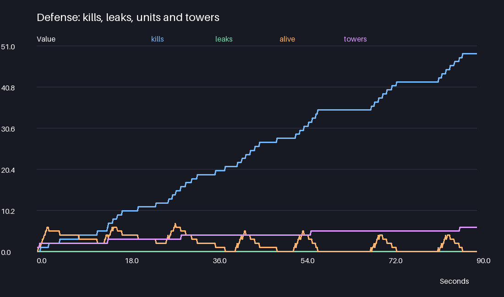
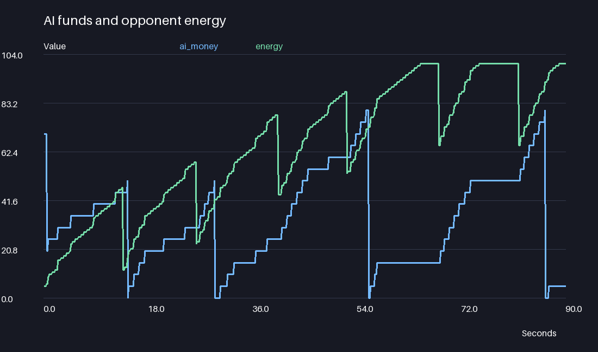
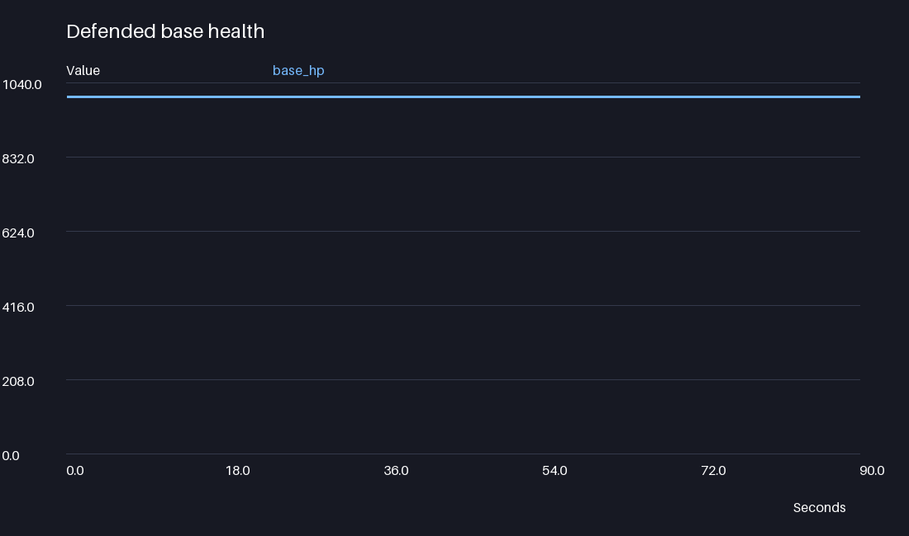
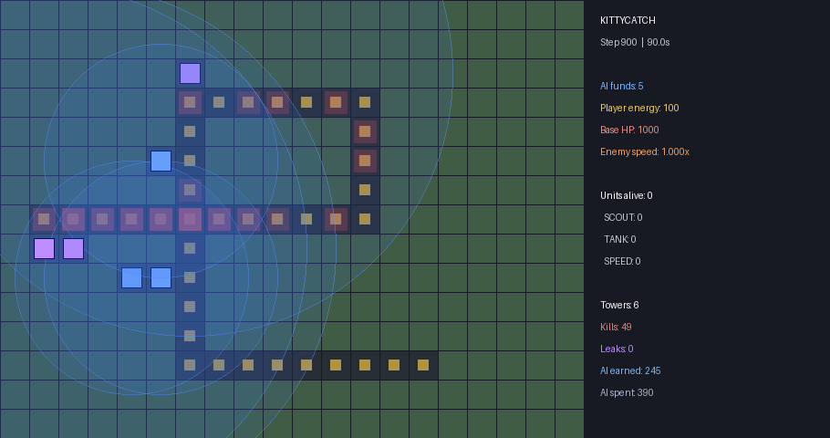

# Raport AI: optymalizacja stawiania wież

## Role i cel eksperymentu

**AI broni bazy: wybiera typ, miejsce i czas budowy wież. Gołębie wysyła przeciwnik.** Jedyną akcją modelu jest `build_tower`, zgodna z istniejącym socketem Godota. Wcześniejszy eksperyment optymalizujący fale miał odwrócone role i nie stanowi wyniku tego treningu.

Cel: minimalizacja obrażeń otrzymanych przez bazę. Fitness = −liczba przecieków + 0,1 × zabite / max(faktycznie wysłane gołębie, 1). Wyższy fitness jest lepszy; na wykresie porównawczym niższe obrażenia są lepsze. Premia za zabicia rozstrzyga remisy. Podstawowym kryterium selekcji jest średnia fitness po ziarnach treningowych.

## Wyniki na oddzielnych scenariuszach testowych

| Strategia obrony | Śr. obrażenia ↓ | Odchylenie | Min–maks | Śr. zabicia | Śr. wieże |
| --- | --- | --- | --- | --- | --- |
| GENETIC | 0.00 | 0.00 | 0–0 | 35.0 | 5.9 |
| BASIC | 0.00 | 0.00 | 0–0 | 34.6 | 7.8 |
| SNIPER | 7.00 | 5.90 | 0–15 | 25.9 | 3.9 |
| MIXED | 0.00 | 0.00 | 0–0 | 34.6 | 6.5 |
| NO_DEFENSE | 23.80 | 6.69 | 15–35 | 0.0 | 0.0 |

GENETIC: zwycięzca treningu. BASIC / SNIPER / MIXED: heurystyki pokrycia trasy, odpowiednio jeden typ lub typy naprzemienne; wszystkie mają tyle samo slotów budowy. NO_DEFENSE: kontrola bez wież. Chromosom nie jest wybierany na podstawie testu.



## Parametry treningu

| Parametr | Wartość |
| --- | --- |
| population | 32 |
| generations | 30 |
| slots | 10 |
| duration | 90 |
| dt | 0.1 |
| seed | 42 |
| mutation_rate | 0.15 |
| train_seeds | [10, 11, 12, 13, 14] |
| test_seeds | [100, 101, 102, 103, 104, 105, 106, 107, 108, 109] |

Selekcja turniejowa: 3 osobniki. Krzyżowanie: niezależnie każdy gen od jednego z rodziców (50/50). Mutacja: szum Gaussa σ=0,15 i obcięcie do [0,1]. Elitaryzm: max(1, populacja // 8). Populacja początkowa zawiera heurystyki pokrycia trasy. Losowe plany zaczynają od czasów w pierwszych 20% epizodu.

Fitness najlepszego osobnika: 0.0968 → 0.0981.





## Chromosom i jego interpretacja

Chromosom ma **40 genów**, czyli **10 slotów budowy**. Każda czwórka to `[typ, x, y, najwcześniejszy_czas]`. Kolejność typów: BASIC, SNIPER. Slot nie jest gwarancją zbudowania wieży: potrzeba środków, wolnego pola i potwierdzenia poprzedniej komendy.

Typ = min(liczba_typów − 1, int(gen × liczba_typów)). x = round(gen × (szerokość − 1)), y = round(gen × (wysokość − 1)). Najwcześniejszy czas = gen × limit epizodu. Sloty są przeglądane według czasu, potem indeksu. Jeśli wybrane pole jest niedostępne, model wybiera najbliższe aktualnie wolne pole budowy według odległości kwadratowej; remisy rozstrzyga (x,y). Nie blokuje tańszych gotowych slotów, gdy na droższy brakuje pieniędzy.

```json
{
  "tower_types": [
    "BASIC",
    "SNIPER"
  ],
  "genes": [
    1,
    0.31367731419499123,
    0.14861463265099886,
    0,
    0.5138092222820196,
    0.09659728491970582,
    0.5938111951195633,
    0,
    0.3714663047324758,
    0.2052885050033292,
    0.62113643267838,
    0,
    0.623846894512127,
    0.3684210526315789,
    0.8698627065364382,
    0.10886793304421989,
    0.6611830428533678,
    0.3302000360425964,
    0.42857142857142855,
    0.006131419676181183,
    0.75,
    0.02806486662780236,
    0.8266311596500596,
    0.01428196737116283,
    0.40240038705772463,
    0.30761181261423254,
    0.3276286906272371,
    0.09482237724865801,
    0.75,
    0.05260882642552178,
    0.5439797868675825,
    0,
    0.658686224821617,
    0.27210284354621894,
    0.6619386928082612,
    0,
    0.03986078418361305,
    0.27316684436476946,
    0.6547056237030716,
    0.09299763804940285
  ],
  "duration": 90,
  "role": "tower_defense"
}
```

### Odkodowany plan budowy (przed korektą zajętych pól)

| Slot (od 0) | Indeksy genów | Typ | Cel x | Cel y | Najwcześniej [s] |
| --- | --- | --- | --- | --- | --- |
| 0 | 0–3 | SNIPER | 6 | 2 | 0.000 |
| 1 | 4–7 | SNIPER | 2 | 8 | 0.000 |
| 2 | 8–11 | BASIC | 4 | 9 | 0.000 |
| 7 | 28–31 | SNIPER | 1 | 8 | 0.000 |
| 8 | 32–35 | SNIPER | 5 | 9 | 0.000 |
| 4 | 16–19 | SNIPER | 6 | 6 | 0.552 |
| 5 | 20–23 | SNIPER | 1 | 12 | 1.285 |
| 9 | 36–39 | BASIC | 5 | 9 | 8.370 |
| 6 | 24–27 | BASIC | 6 | 5 | 8.534 |
| 3 | 12–15 | SNIPER | 7 | 12 | 9.798 |

## Ustawienia przeciwnika: fale gołębi

Scenariusz = ziarno + profil. Profil wybierany przez seed modulo 5: 0: SCOUT, 1: TANK, 2: SPEED, 3: MIXED, 4: BURST. SCOUT/TANK/SPEED używają jednego typu, MIXED i BURST losują skład. Budżet żądanej fali to 35 energii, a BURST 65, ograniczony maksimum energii gracza. Planowany start pierwszej fali: 0 s. Następne odstępy: losowo 11–16 s, BURST 20–26 s.

Harmonogram żądań generowany jest przed epizodem, niezależnie od chromosomu. Koszty i regeneracja obowiązują normalnie: jeśli brakuje energii lub kolejka trwa, przeciwnik czeka. Zabicia zwracają energię graczowi, więc rzeczywiste czasy i liczba wysłanych fal mogą różnić się między strategiami. Nie traktujemy takich przebiegów jako identycznych fal w identycznym czasie.

| Seed | Profil | Obrażenia ↓ | HP bazy | Zabicia | Wysłane | Wieże | Wydatek AI | Odrzucone |
| --- | --- | --- | --- | --- | --- | --- | --- | --- |
| 100 | SCOUT | 0 | 1000 | 49 | 49 | 6 | 390 | 0 |
| 101 | TANK | 0 | 1000 | 23 | 24 | 6 | 390 | 0 |
| 102 | SPEED | 0 | 1000 | 35 | 35 | 6 | 390 | 0 |
| 103 | MIXED | 0 | 1000 | 33 | 33 | 6 | 390 | 0 |
| 104 | BURST | 0 | 1000 | 38 | 38 | 6 | 390 | 0 |
| 105 | SCOUT | 0 | 1000 | 46 | 49 | 5 | 310 | 0 |
| 106 | TANK | 0 | 1000 | 21 | 21 | 6 | 390 | 0 |
| 107 | SPEED | 0 | 1000 | 35 | 35 | 6 | 390 | 0 |
| 108 | MIXED | 0 | 1000 | 34 | 34 | 6 | 390 | 0 |
| 109 | BURST | 0 | 1000 | 36 | 36 | 6 | 390 | 0 |

## Balans gry i ekonomia

| Wieża | Koszt | Zasięg [kafle] | Obrażenia | Ataki/s |
| --- | --- | --- | --- | --- |
| BASIC | 50 | 2.0 | 9 | 1.25 |
| SNIPER | 80 | 4.5 | 12 | 0.25 |

| Gołąb | HP | Szybkość [kafle/s] | Koszt energii | Nagroda dla AI |
| --- | --- | --- | --- | --- |
| SCOUT | 10 | 1.0 | 5 | 5 |
| TANK | 20 | 0.8 | 10 | 12 |
| SPEED | 15 | 1.2 | 7 | 8 |

```json
{
  "economy": {
    "player": {
      "starting_energy": 40,
      "max_energy": 100,
      "energy_regen_per_second": 2.0,
      "kill_energy_refund_fraction": 0.6
    },
    "ai": {
      "starting_money": 150
    }
  },
  "combat": {
    "enemy_speed_bonus_per_base_hit": 0.005,
    "max_enemy_speed_bonus": 0.1
  },
  "map": {
    "tile_size_px": 64,
    "cell_size_px": 32,
    "width_tiles": 20,
    "height_tiles": 15
  }
}
```

Zdrowie startowe bazy: 1000. Każdy przeciek zadaje 1 obrażenie. Wieże finansowane są z funduszy AI oraz nagród za zabicia. Energia służy wyłącznie przeciwnikowi do wysyłania gołębi.

## Jedna rozgrywka zwycięskiej obrony

Seed **100**, profil **SCOUT**. Wybrany jawnie lub jako pierwszy z listy testowej; nie wybieramy najlepszego testu do animacji. Czas: 90.0 s. Baza: **1000 HP**, przecieki: **0**, zabicia: **49**, wieże AI: **6**.



Animacja lokalnej symulacji: 181 klatek, próbki co około 0,5 s, odtwarzanie 3× i pauza na końcu.

### Faktyczne budowy wież przez AI

| Czas [s] | Slot | Typ | x | y | Koszt |
| --- | --- | --- | --- | --- | --- |
| 0.0 | 0 | SNIPER | 6 | 2 | 80 |
| 0.5 | 2 | BASIC | 4 | 9 | 50 |
| 14.5 | 9 | BASIC | 5 | 9 | 50 |
| 29.5 | 6 | BASIC | 5 | 5 | 50 |
| 56.0 | 1 | SNIPER | 2 | 8 | 80 |
| 86.5 | 7 | SNIPER | 1 | 8 | 80 |

Niewykonane sloty: 8, 4, 5, 3. Mogły oczekiwać na pieniądze, najwcześniejszy czas lub wolne pole do końca epizodu.

### Fale przeciwnika: planowane i rzeczywiste czasy

| Fala | Plan [s] | Start [s] | SCOUT | TANK | SPEED | Koszt energii |
| --- | --- | --- | --- | --- | --- | --- |
| 1 | 0.0 | 0.0 | 7 | 0 | 0 | 35 |
| 2 | 13.5 | 13.6 | 7 | 0 | 0 | 35 |
| 3 | 26.2 | 26.3 | 7 | 0 | 0 | 35 |
| 4 | 40.3 | 40.4 | 7 | 0 | 0 | 35 |
| 5 | 52.2 | 52.3 | 7 | 0 | 0 | 35 |
| 6 | 68.1 | 68.1 | 7 | 0 | 0 | 35 |
| 7 | 81.8 | 81.9 | 7 | 0 | 0 | 35 |

### Bilans gołębi według typu

| Typ | Wysłane | Zabite | Dotarły do bazy | Na trasie | W kolejce |
| --- | --- | --- | --- | --- | --- |
| SCOUT | 49 | 49 | 0 | 0 | 0 |
| TANK | 0 | 0 | 0 | 0 | 0 |
| SPEED | 0 | 0 | 0 | 0 | 0 |











## Uruchomienie AI przez socket Godota

Z katalogu python_ai uruchom serwer, następnie otwórz godot_game/project.godot i uruchom grę (F6/F5 zgodnie z projektem):

```powershell
python -m src.serwer --strategy training_results/best_strategy.json --host 127.0.0.1 --port 8080
```

Godot jest klientem TCP. Python odbiera init i update, odsyła JSON UTF-8 zakończony znakiem nowej linii. Przykład akcji:

```json
{"action":"build_tower","command_id":"ga-episode-step-seq-s0","tower_type":"BASIC","x":3,"y":3}
```

Model nie wysyła fal. Kontroluje budżet i wolne pola w aktualnej obserwacji. Wysyła maksymalnie jedną komendę na 0,5 s i czeka na action_result. Powtórzone lub starsze update nie generują kolejnych komend; init nowego epizodu resetuje plan. Po 2 s bez potwierdzenia sprawdza zajętość pola i rozstrzyga, czy ponowić slot. Sam Godot ostatecznie zatwierdza koszt, typ i położenie wieży.

## Pliki, odtwarzalność i ograniczenia

- [Chromosom obrony](best_strategy.json)
- [Dane eksperymentu](report.json), [pełne przebiegi, zdarzenia i plan](detailed_report.json)
- [Budowy wszystkich testów](builds.csv), [fale przeciwnika](waves.csv), [pojawienia się gołębi](spawns.csv)
- [Trening](generations.csv), [porównanie](comparison.csv), [przebieg wybranej gry](replay.csv)

```powershell
python -m src.experiment_report --input training_results/report.json --gif --replay-seed 100
python -m src.pdf_report --input training_results/report.md
```

Wyniki dotyczą jednej mapy, zapisanej konfiguracji i badanych profili gołębi. Algorytm wybiera najlepszy sprawdzony plan, bez dowodu globalnego optimum. Limit slotów ogranicza liczbę wież. Wynik lokalnej symulacji nie jest wynikiem meczu w Godocie; fizyka, dyskretny krok i opóźnienia sieci mogą zmienić rezultat. Integracja socketu jest testowana protokołem; rzeczywisty mecz wymaga uruchomionego Godota.
