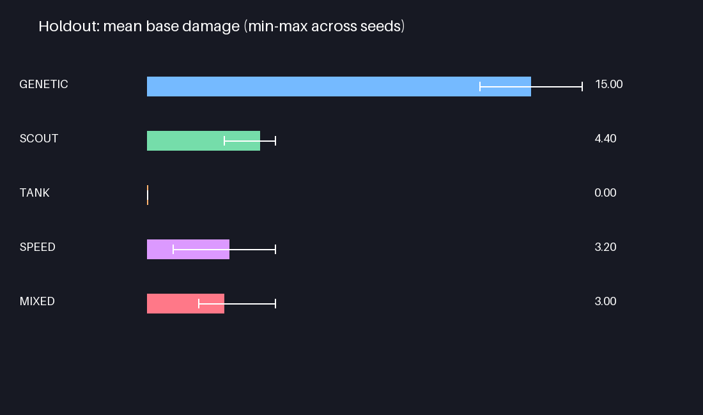
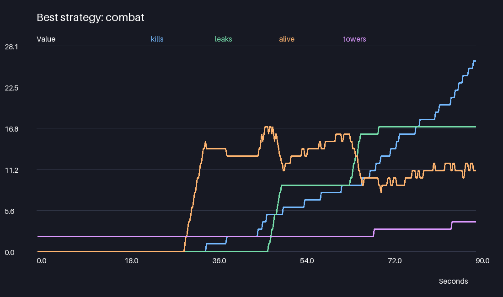
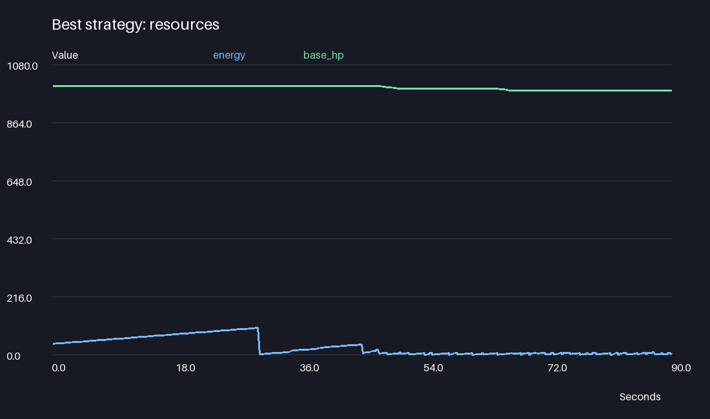

# Wyniki optymalizacji fal golebi

Cel: maksymalizacja srednich obrazen bazy w zadanym czasie.
Wynik dotyczy lokalnego modelu i testowanego przeciwnika; nie gwarantuje globalnego optimum.

| Strategia | Srednie obrazenia na testach | Odchylenie standardowe |
|---|---:|---:|
| GENETIC | 15.00 | 1.41 |
| SCOUT | 4.40 | 0.80 |
| TANK | 0.00 | 0.00 |
| SPEED | 3.20 | 1.33 |
| MIXED | 3.00 | 1.10 |

