# Sprawozdanie: nowe układy obrony KittyCatch

## Role i cel eksperymentu

**AI broni bazy: wybiera typ, miejsce i czas budowy wież. Gołębie wysyła przeciwnik.** Jedyną akcją modelu jest `build_tower`, zgodna z istniejącym socketem Godota. Badanie dotyczy limitu energii 100, bazy 200 HP i epizodów długości 120 s.

Cel: minimalizacja obrażeń otrzymanych przez bazę. Fitness = −liczba przecieków + 0,1 × zabite / max(faktycznie wysłane gołębie, 1). Wyższy fitness jest lepszy; na wykresie porównawczym niższe obrażenia są lepsze. Premia za zabicia rozstrzyga remisy. Podstawowym kryterium selekcji jest średnia fitness po ziarnach treningowych.

## Zmiany zasad uwzględnione w eksperymencie

| Parametr | Poprzednia konfiguracja | Aktualna konfiguracja |
| --- | --- | --- |
| HP bazy | 1000 | 200 |
| Zwrot energii za zabicie | 60% | 100% |
| SCOUT: HP | 10 | 10 |
| SCOUT: prędkość | 1.0 | 1.0 |
| SCOUT: koszt | 5 | 5 |
| TANK: HP | 20 | 30 |
| TANK: prędkość | 0.8 | 0.8 |
| TANK: koszt | 10 | 10 |
| SPEED: HP | 15 | 15 |
| SPEED: prędkość | 1.2 | 1.4 |
| SPEED: koszt | 7 | 7 |

Mniejsze HP bazy zapisano w balance.json i podłączono do startu poziomu. Wcześniej zmienna base_health=200 była nadpisywana przez start_new_game(1000). Teraz Godot i symulator zaczynają z 200 HP. Przyspieszonym typem zapisanym w pliku jest SPEED; SCOUT ma nadal prędkość 1,0 kafla/s.

Dotarcie do celu zwraca ceil(koszt/2): SCOUT 3, TANK 5, SPEED 4. Zwrot za zabicie wynosi obecnie pełny koszt jednostki; oba zwroty respektują limit energii.

## Wyniki na oddzielnych scenariuszach testowych

| Strategia obrony | Śr. obrażenia ↓ | Odchylenie | Min–maks | Śr. zabicia | Śr. wieże |
| --- | --- | --- | --- | --- | --- |
| GENETIC | 0.00 | 0.00 | 0–0 | 45.8 | 8.8 |
| BASIC | 0.00 | 0.00 | 0–0 | 45.7 | 9.4 |
| SNIPER | 9.85 | 6.56 | 1–21 | 33.2 | 4.6 |
| MIXED | 0.00 | 0.00 | 0–0 | 45.1 | 7.5 |
| NO_DEFENSE | 40.55 | 10.19 | 24–56 | 0.0 | 0.0 |
| GA_137 | 0.00 | 0.00 | 0–0 | 45.8 | 8.5 |
| GA_2026 | 0.00 | 0.00 | 0–0 | 45.9 | 9.1 |
| PREVIOUS | 0.00 | 0.00 | 0–0 | 45.8 | 6.8 |

GENETIC: zwycięzca treningu. BASIC / SNIPER / MIXED: heurystyki pokrycia trasy, odpowiednio jeden typ lub typy naprzemienne; wszystkie mają tyle samo slotów budowy. NO_DEFENSE: kontrola bez wież. Chromosom nie jest wybierany na podstawie testu.

GA_z: zwycięzca niezależnego przebiegu o ziarnie z. PREVIOUS: poprzedni chromosom ponownie oceniony na aktualnym balansie i tych samych scenariuszach, z zachowaniem jego zapisanych czasów budowy. Nie mieszamy historycznych wyników uzyskanych przy innych zasadach z aktualnym testem.

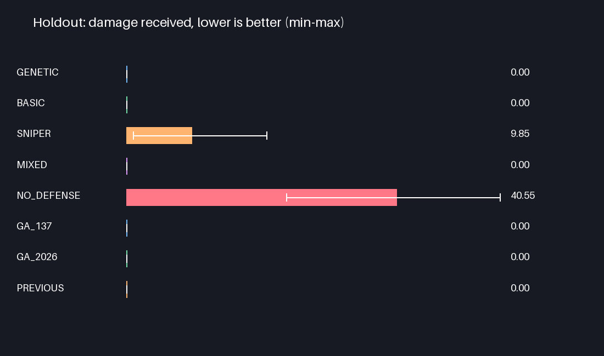

## Nowe warianty rozmieszczenia wież

Każdy wariant pochodzi z osobnego treningu. Główny zwycięzca został wybrany według fitness treningowego, przed testem. Przy równych wynikach pomiędzy przebiegami wygrywa pierwszy. Poniższe mapy pokazują faktycznie zbudowane wieże na tym samym pierwszym scenariuszu testowym; niewykonane sloty pozostają tylko w chromosomie. Numery oznaczają kolejność budowy.

| Ziarno treningu | Fitness treningowy | Wybrany model | Plik strategii |
| --- | --- | --- | --- |
| 42 | 0.100000 | TAK | strategy_seed_42.json |
| 137 | 0.100000 | — | strategy_seed_137.json |
| 2026 | 0.100000 | — | strategy_seed_2026.json |

### Układ z przebiegu 42

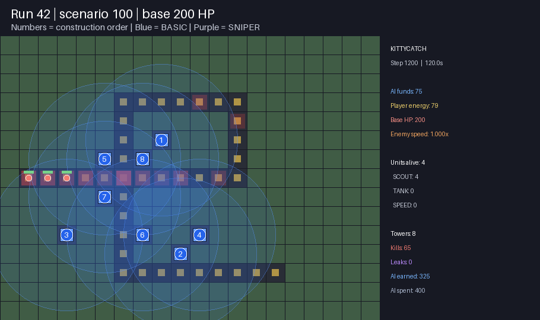

| Nr | Start [s] | Slot | Typ | x | y |
| --- | --- | --- | --- | --- | --- |
| 1 | 0.0 | 1 | BASIC | 8 | 5 |
| 2 | 0.5 | 3 | BASIC | 9 | 11 |
| 3 | 1.0 | 6 | BASIC | 3 | 10 |
| 4 | 17.0 | 7 | BASIC | 10 | 10 |
| 5 | 32.5 | 4 | BASIC | 5 | 6 |
| 6 | 54.0 | 2 | BASIC | 7 | 10 |
| 7 | 72.5 | 9 | BASIC | 5 | 8 |
| 8 | 95.0 | 0 | BASIC | 7 | 6 |

### Układ z przebiegu 137

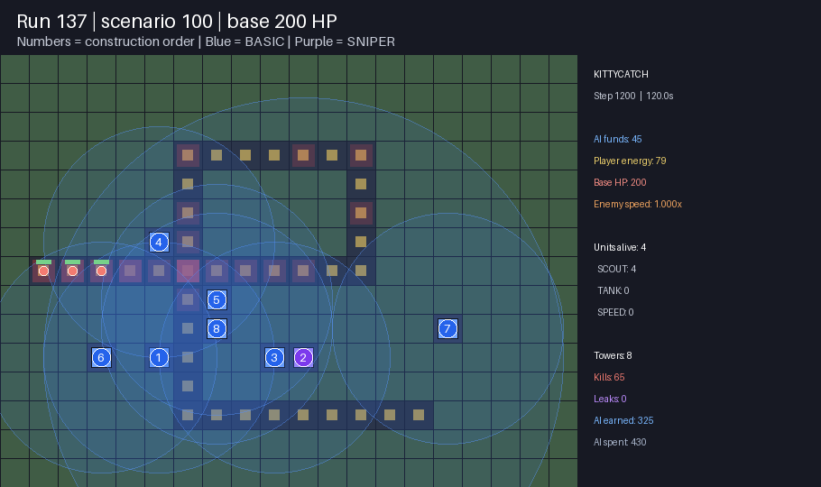

| Nr | Start [s] | Slot | Typ | x | y |
| --- | --- | --- | --- | --- | --- |
| 1 | 0.0 | 0 | BASIC | 5 | 10 |
| 2 | 2.5 | 7 | SNIPER | 10 | 10 |
| 3 | 15.0 | 4 | BASIC | 9 | 10 |
| 4 | 30.5 | 2 | BASIC | 5 | 6 |
| 5 | 44.5 | 9 | BASIC | 7 | 8 |
| 6 | 69.5 | 3 | BASIC | 3 | 10 |
| 7 | 85.0 | 1 | BASIC | 15 | 9 |
| 8 | 99.5 | 5 | BASIC | 7 | 9 |

### Układ z przebiegu 2026

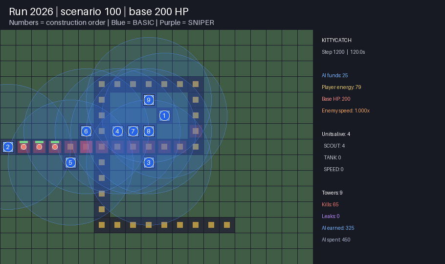

| Nr | Start [s] | Slot | Typ | x | y |
| --- | --- | --- | --- | --- | --- |
| 1 | 0.0 | 0 | BASIC | 10 | 5 |
| 2 | 0.5 | 3 | BASIC | 0 | 7 |
| 3 | 1.0 | 4 | BASIC | 9 | 8 |
| 4 | 18.0 | 9 | BASIC | 7 | 6 |
| 5 | 32.0 | 2 | BASIC | 4 | 8 |
| 6 | 54.0 | 1 | BASIC | 5 | 6 |
| 7 | 72.0 | 7 | BASIC | 8 | 6 |
| 8 | 95.0 | 6 | BASIC | 9 | 6 |
| 9 | 108.5 | 8 | BASIC | 9 | 4 |

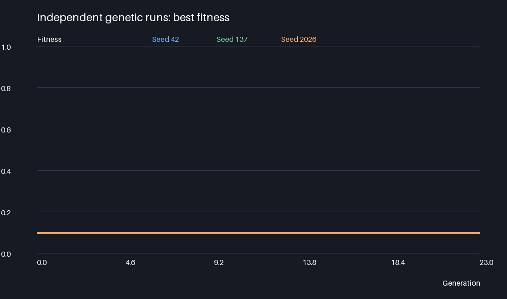

## Parametry treningu

| Parametr | Wartość |
| --- | --- |
| population | 24 |
| generations | 24 |
| slots | 10 |
| duration | 120.0 |
| dt | 0.1 |
| seed | 42 |
| search_seeds | [42, 137, 2026] |
| mutation_rate | 0.15 |
| train_seeds | [10, 11, 12, 13, 14] |
| test_seeds | [100, 101, 102, 103, 104, 105, 106, 107, 108, 109, 110, 111, 112, 113, 114, 115, 116, 117, 118, 119] |

Selekcja turniejowa: 3 osobniki. Krzyżowanie: niezależnie każdy gen od jednego z rodziców (50/50). Mutacja: szum Gaussa σ=0,15 i obcięcie do [0,1]. Elitaryzm: max(1, populacja // 8). Populacja początkowa zawiera heurystyki pokrycia trasy. Losowe plany zaczynają od czasów w pierwszych 20% epizodu. Remisy fitness wewnątrz populacji rozstrzyga losowanie kontrolowane ziarnem przebiegu, co pozwala zachować różne równie skuteczne układy.

Identyfikator konfiguracji SHA-256: 9b86a3c0f4c4dfc6fc1bfc6f12f3e0011795080e6de2df63e39f0f660fcb5542.

Fitness najlepszego osobnika: 0.1000 → 0.1000.

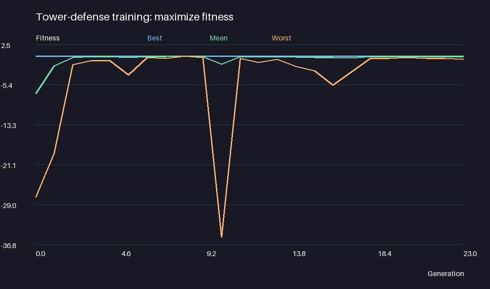

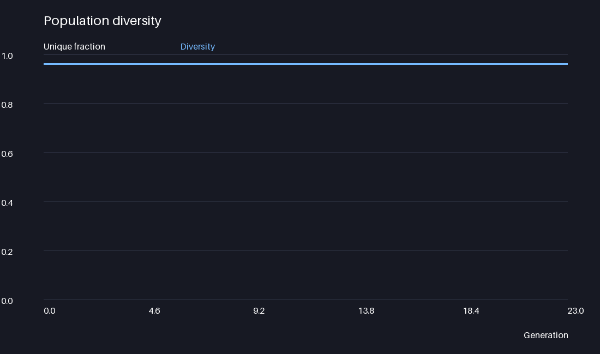

Najlepszy wynik był osiągalny już w populacji początkowej. Trening nie poprawił tego kryterium; zbadał alternatywne układy i ich odporność na zmianę scenariusza. Różne chromosomy z takim samym fitness nie są dowodem przewagi nad heurystyką.

## Chromosom i jego interpretacja

Chromosom ma **40 genów**, czyli **10 slotów budowy**. Każda czwórka to `[typ, x, y, najwcześniejszy_czas]`. Kolejność typów: BASIC, SNIPER. Slot nie jest gwarancją zbudowania wieży: potrzeba środków, wolnego pola i potwierdzenia poprzedniej komendy.

Typ = min(liczba_typów − 1, int(gen × liczba_typów)). x = round(gen × (szerokość − 1)), y = round(gen × (wysokość − 1)). Najwcześniejszy czas = gen × limit epizodu. Sloty są przeglądane według czasu, potem indeksu. Jeśli wybrane pole jest niedostępne, model wybiera najbliższe aktualnie wolne pole budowy według odległości kwadratowej; remisy rozstrzyga (x,y). Nie blokuje tańszych gotowych slotów, gdy na droższy brakuje pieniędzy.

```json
{
  "tower_types": [
    "BASIC",
    "SNIPER"
  ],
  "genes": [
    0.14183783074988082,
    0.39375302968145975,
    0.45730171160827215,
    0.19899852933660428,
    0.26144660206485143,
    0.43341335981282003,
    0.3876377478656289,
    0,
    0.34438387887483624,
    0.34492663041186605,
    0.7081096520140672,
    0.08851980292351014,
    0,
    0.4644411270380717,
    0.7819816873424573,
    0,
    0.3143483813277008,
    0.2378178834817425,
    0.5007692070602487,
    0.0691624634140748,
    0.8712171241469235,
    0.4131883983641613,
    0.17136591390864508,
    0.0028040414217457565,
    0.08874197319836583,
    0.14805619023914207,
    0.7104795501794743,
    0,
    0.16617958825554432,
    0.5484671780987611,
    0.7057065619483267,
    0,
    0.6828429950349976,
    1,
    0.8134880609950386,
    0.053306259484712536,
    0.24756851002452485,
    0.26623994700409315,
    0.5204069759233919,
    0.1600652099273414
  ],
  "duration": 120.0,
  "role": "tower_defense"
}
```

### Odkodowany plan budowy (przed korektą zajętych pól)

| Slot (od 0) | Indeksy genów | Typ | Cel x | Cel y | Najwcześniej [s] |
| --- | --- | --- | --- | --- | --- |
| 1 | 4–7 | BASIC | 8 | 5 | 0.000 |
| 3 | 12–15 | BASIC | 9 | 11 | 0.000 |
| 6 | 24–27 | BASIC | 3 | 10 | 0.000 |
| 7 | 28–31 | BASIC | 10 | 10 | 0.000 |
| 5 | 20–23 | SNIPER | 8 | 2 | 0.336 |
| 8 | 32–35 | SNIPER | 19 | 11 | 6.397 |
| 4 | 16–19 | BASIC | 5 | 7 | 8.299 |
| 2 | 8–11 | BASIC | 7 | 10 | 10.622 |
| 9 | 36–39 | BASIC | 5 | 7 | 19.208 |
| 0 | 0–3 | BASIC | 7 | 6 | 23.880 |

## Ustawienia przeciwnika: fale gołębi

Scenariusz = ziarno + profil. Profil wybierany przez seed modulo 5: 0: SCOUT, 1: TANK, 2: SPEED, 3: MIXED, 4: BURST. SCOUT/TANK/SPEED używają jednego typu, MIXED i BURST losują skład. Budżet żądanej fali to 35 energii, a BURST 65, ograniczony maksimum energii gracza. Planowany start pierwszej fali: 0 s. Następne odstępy: losowo 11–16 s, BURST 20–26 s.

Harmonogram żądań generowany jest przed epizodem, niezależnie od chromosomu. Koszty i regeneracja obowiązują normalnie: jeśli brakuje energii lub kolejka trwa, przeciwnik czeka. Zabicia zwracają energię graczowi, więc rzeczywiste czasy i liczba wysłanych fal mogą różnić się między strategiami. Nie traktujemy takich przebiegów jako identycznych fal w identycznym czasie.

| Seed | Profil | Obrażenia ↓ | HP bazy | Zabicia | Wysłane | Wieże | Wydatek AI | Odrzucone |
| --- | --- | --- | --- | --- | --- | --- | --- | --- |
| 100 | SCOUT | 0 | 200 | 65 | 69 | 8 | 400 | 0 |
| 101 | TANK | 0 | 200 | 30 | 30 | 9 | 480 | 0 |
| 102 | SPEED | 0 | 200 | 45 | 45 | 9 | 480 | 0 |
| 103 | MIXED | 0 | 200 | 42 | 42 | 8 | 400 | 0 |
| 104 | BURST | 0 | 200 | 46 | 46 | 9 | 480 | 0 |
| 105 | SCOUT | 0 | 200 | 60 | 63 | 8 | 400 | 0 |
| 106 | TANK | 0 | 200 | 30 | 30 | 9 | 480 | 0 |
| 107 | SPEED | 0 | 200 | 45 | 45 | 9 | 480 | 0 |
| 108 | MIXED | 0 | 200 | 44 | 44 | 9 | 480 | 0 |
| 109 | BURST | 0 | 200 | 45 | 45 | 9 | 480 | 0 |
| 110 | SCOUT | 0 | 200 | 63 | 63 | 8 | 400 | 0 |
| 111 | TANK | 0 | 200 | 30 | 30 | 9 | 480 | 0 |
| 112 | SPEED | 0 | 200 | 48 | 50 | 9 | 480 | 0 |
| 113 | MIXED | 0 | 200 | 47 | 48 | 9 | 480 | 0 |
| 114 | BURST | 0 | 200 | 47 | 51 | 9 | 480 | 0 |
| 115 | SCOUT | 0 | 200 | 63 | 63 | 8 | 400 | 0 |
| 116 | TANK | 0 | 200 | 27 | 29 | 8 | 400 | 0 |
| 117 | SPEED | 0 | 200 | 45 | 45 | 9 | 480 | 0 |
| 118 | MIXED | 0 | 200 | 41 | 41 | 9 | 480 | 0 |
| 119 | BURST | 0 | 200 | 52 | 52 | 10 | 560 | 0 |

## Balans gry i ekonomia

| Wieża | Koszt | Zasięg [kafle] | Obrażenia | Ataki/s |
| --- | --- | --- | --- | --- |
| BASIC | 50 | 2.0 | 9 | 1.25 |
| SNIPER | 80 | 4.5 | 12 | 0.25 |

| Gołąb | HP | Szybkość [kafle/s] | Koszt energii | Nagroda dla AI |
| --- | --- | --- | --- | --- |
| SCOUT | 10 | 1.0 | 5 | 5 |
| TANK | 30 | 0.8 | 10 | 12 |
| SPEED | 15 | 1.4 | 7 | 8 |

```json
{
  "economy": {
    "player": {
      "starting_energy": 40,
      "max_energy": 100,
      "energy_regen_per_second": 2.0,
      "kill_energy_refund_fraction": 1.0
    },
    "ai": {
      "starting_money": 150
    }
  },
  "combat": {
    "enemy_speed_bonus_per_base_hit": 0.005,
    "max_enemy_speed_bonus": 0.1
  },
  "base": {
    "health": 200
  },
  "map": {
    "tile_size_px": 64,
    "cell_size_px": 32,
    "width_tiles": 20,
    "height_tiles": 15
  }
}
```

Zdrowie startowe bazy: 200. Każdy przeciek zadaje 1 obrażenie. Wieże finansowane są z funduszy AI oraz nagród za zabicia. Energia służy wyłącznie przeciwnikowi do wysyłania gołębi. Zwrot przy dotarciu do celu: ceil(koszt/2).

## Jedna rozgrywka zwycięskiej obrony

Seed **100**, profil **SCOUT**. Wybrany jawnie lub jako pierwszy z listy testowej; nie wybieramy najlepszego testu do animacji. Czas: 120.0 s. Baza: **200 HP**, przecieki: **0**, zabicia: **65**, wieże AI: **8**.

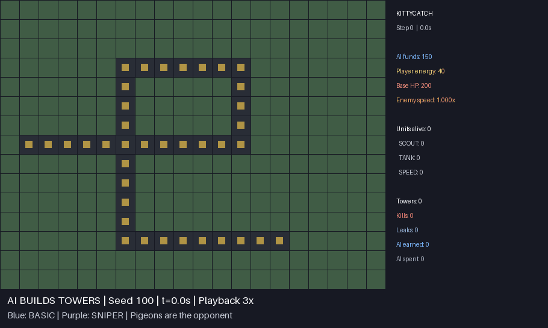

Animacja lokalnej symulacji: 241 klatek, próbki co około 0,5 s, odtwarzanie 3× i pauza na końcu.

### Faktyczne budowy wież przez AI

| Czas [s] | Slot | Typ | x | y | Koszt |
| --- | --- | --- | --- | --- | --- |
| 0.0 | 1 | BASIC | 8 | 5 | 50 |
| 0.5 | 3 | BASIC | 9 | 11 | 50 |
| 1.0 | 6 | BASIC | 3 | 10 | 50 |
| 17.0 | 7 | BASIC | 10 | 10 | 50 |
| 32.5 | 4 | BASIC | 5 | 6 | 50 |
| 54.0 | 2 | BASIC | 7 | 10 | 50 |
| 72.5 | 9 | BASIC | 5 | 8 | 50 |
| 95.0 | 0 | BASIC | 7 | 6 | 50 |

Niewykonane sloty: 5, 8. Mogły oczekiwać na pieniądze, najwcześniejszy czas lub wolne pole do końca epizodu.

### Fale przeciwnika: planowane i rzeczywiste czasy

| Fala | Plan [s] | Start [s] | SCOUT | TANK | SPEED | Koszt energii |
| --- | --- | --- | --- | --- | --- | --- |
| 1 | 0.0 | 0.0 | 7 | 0 | 0 | 35 |
| 2 | 13.5 | 13.6 | 7 | 0 | 0 | 35 |
| 3 | 26.2 | 26.3 | 7 | 0 | 0 | 35 |
| 4 | 40.3 | 40.4 | 7 | 0 | 0 | 35 |
| 5 | 52.2 | 52.3 | 7 | 0 | 0 | 35 |
| 6 | 68.1 | 68.1 | 7 | 0 | 0 | 35 |
| 7 | 81.8 | 81.9 | 7 | 0 | 0 | 35 |
| 8 | 94.1 | 94.1 | 7 | 0 | 0 | 35 |
| 9 | 105.3 | 105.4 | 7 | 0 | 0 | 35 |
| 10 | 118.0 | 118.1 | 7 | 0 | 0 | 35 |

### Bilans gołębi według typu

| Typ | Wysłane | Zabite | Dotarły do bazy | Na trasie | W kolejce |
| --- | --- | --- | --- | --- | --- |
| SCOUT | 69 | 65 | 0 | 4 | 1 |
| TANK | 0 | 0 | 0 | 0 | 0 |
| SPEED | 0 | 0 | 0 | 0 | 0 |

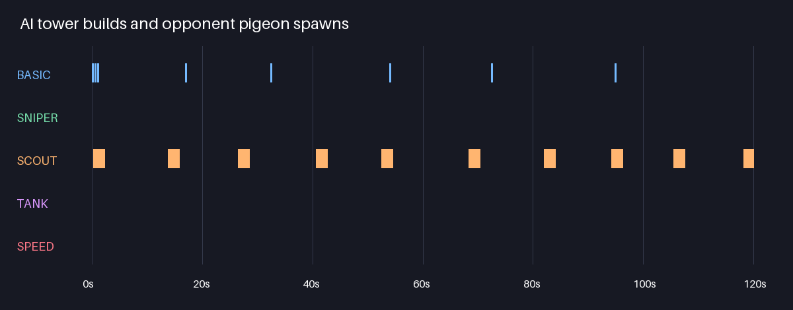

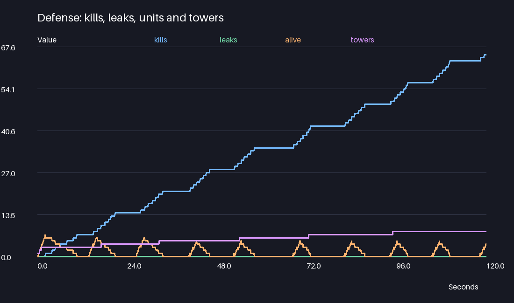

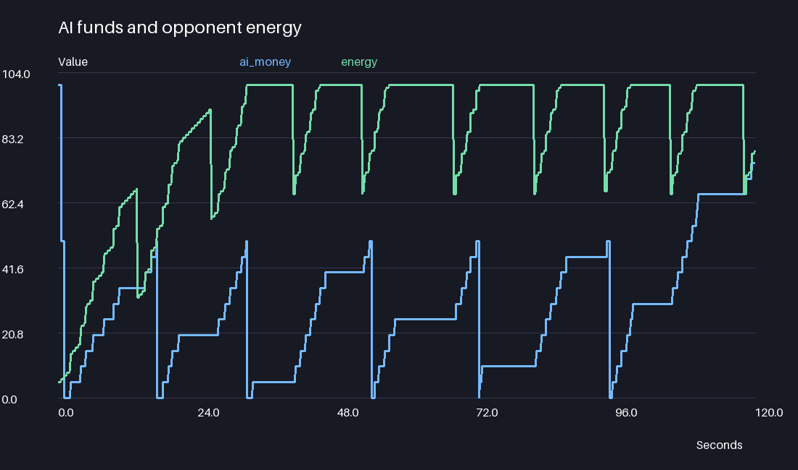

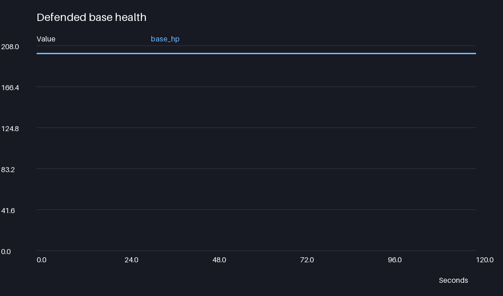

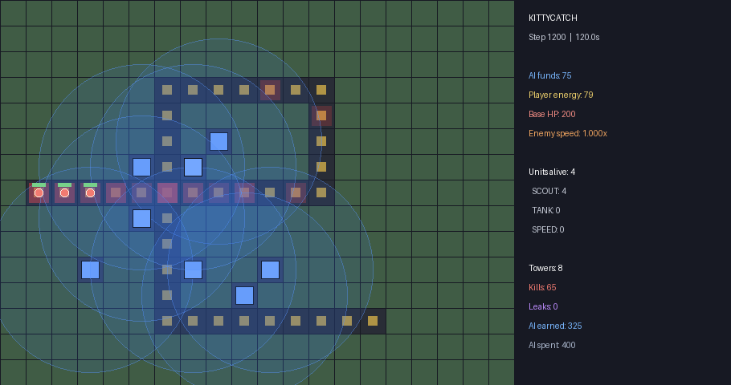

## Uruchomienie AI przez socket Godota

Z katalogu python_ai uruchom serwer, następnie otwórz godot_game/project.godot i uruchom grę (F6/F5 zgodnie z projektem):

```powershell
python -m src.serwer --strategy training_results/best_strategy.json --host 127.0.0.1 --port 8080
```

Godot jest klientem TCP. Python odbiera init i update, odsyła JSON UTF-8 zakończony znakiem nowej linii. Przykład akcji:

```json
{"action":"build_tower","command_id":"ga-episode-step-seq-s0","tower_type":"BASIC","x":3,"y":3}
```

Model nie wysyła fal. Kontroluje budżet i wolne pola w aktualnej obserwacji. Wysyła maksymalnie jedną komendę na 0,5 s i czeka na action_result. Powtórzone lub starsze update nie generują kolejnych komend; init nowego epizodu resetuje plan. Po 2 s bez potwierdzenia sprawdza zajętość pola i rozstrzyga, czy ponowić slot. Sam Godot ostatecznie zatwierdza koszt, typ i położenie wieży.

## Pliki, odtwarzalność i ograniczenia

- [Chromosom obrony](best_strategy.json)
- [Dane eksperymentu](report.json), [pełne przebiegi, zdarzenia i plan](detailed_report.json)
- [Budowy wszystkich testów](builds.csv), [fale przeciwnika](waves.csv), [pojawienia się gołębi](spawns.csv)
- [Trening](generations.csv), [Porównanie](comparison.csv), [przebieg wybranej gry](replay.csv)

```powershell
python -m src.experiment_report --input training_results/report.json --gif --replay-seed 100
python -m src.pdf_report --input training_results/report.md
```

Wyniki dotyczą jednej mapy, zapisanej konfiguracji i badanych profili gołębi. Algorytm wybiera najlepszy sprawdzony plan, bez dowodu globalnego optimum. Limit slotów ogranicza liczbę wież. Wynik lokalnej symulacji nie jest wynikiem meczu w Godocie; fizyka, dyskretny krok i opóźnienia sieci mogą zmienić rezultat. Integracja socketu jest testowana protokołem; rzeczywisty mecz wymaga uruchomionego Godota.
