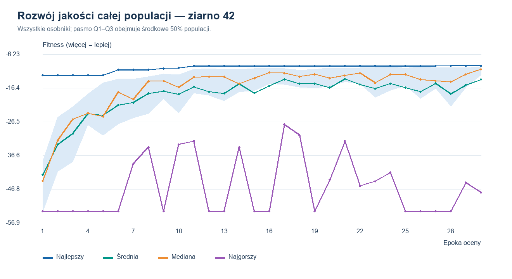
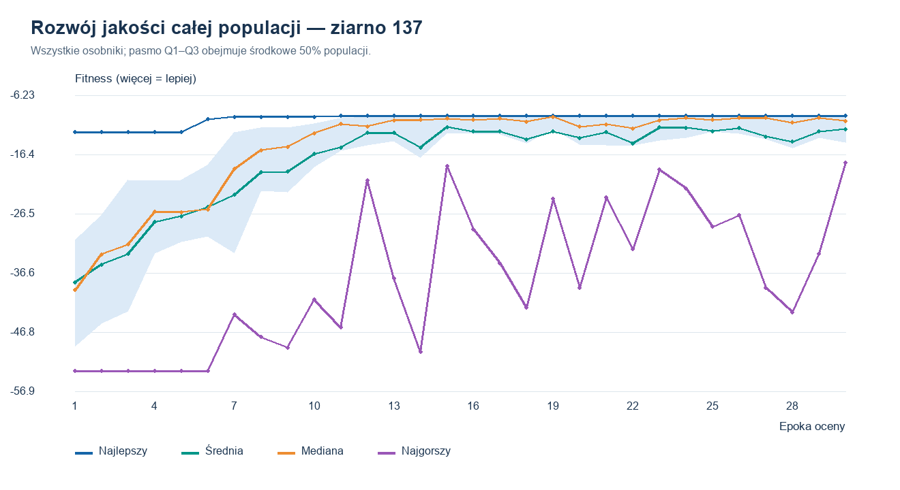
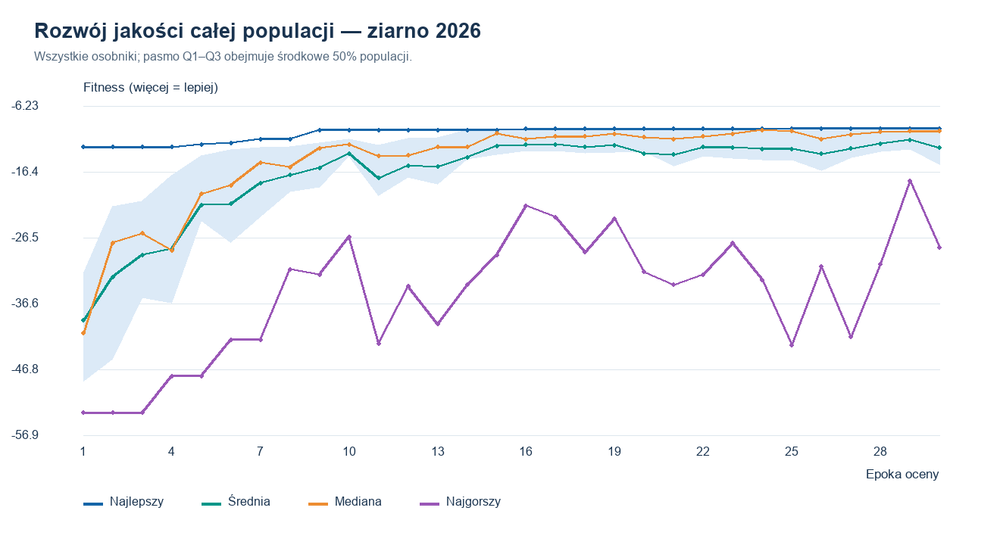

# Rozwój jakości całej populacji

Każdy wykres obejmuje wszystkie 32 osobniki w każdej z 30 epok. Trzy przebiegi mają różne ziarna inicjalizacji i operatorów, ale wspólne scenariusze treningowe. Wyższy fitness oznacza lepszą obronę.

## Jak czytać wykres

Najlepszy osobnik pokazuje jakość elity. Średnia opisuje przeciętną ocenę wszystkich osobników; słabe mutacje mogą ją obniżyć. Mediana dzieli populację na dwie równe części i jest mniej wrażliwa na pojedyncze bardzo słabe plany. Najgorszy pokazuje dolny skraj jakości. Jasne pasmo Q1–Q3 obejmuje środkowe 50% osobników; nie jest przedziałem ufności.

Elitaryzm zachowuje najlepsze rozwiązania, lecz nie wymusza wzrostu średniej lub najgorszej oceny. Mutacja i krzyżowanie tworzą również gorszych potomków. Epoka 1 to populacja początkowa, zawierająca także trzy heurystyki. Krzywe pochodzą z ocen treningowych, nie z testu.

Fitness epizodu: F = −L + 0,1 × K / max(N, 1), gdzie L oznacza przecieki, K zabicia, N wysłane jednostki. Ocena osobnika jest średnią po pięciu scenariuszach. Wynik −10 jest lepszy od −20.

## Cała populacja — przebieg 42

| Miara | Epoka 1 | Ostatnia epoka |
|---|---:|---:|
| Najlepszy | -12.5280 | -9.7212 |
| Średnia | -42.5058 | -13.8042 |
| Mediana | -44.2848 | -10.7245 |
| Najgorszy | -53.4000 | -47.7898 |

Spadki średniej wskazują na gorsze oceny części potomków; nie oznaczają automatycznie utraty najlepszego planu. Poprawę całej populacji oceniamy łącznie ze zmianą mediany i kwartylów.

## Cała populacja — przebieg 137

| Miara | Epoka 1 | Ostatnia epoka |
|---|---:|---:|
| Najlepszy | -12.5280 | -9.7199 |
| Średnia | -38.2230 | -11.9944 |
| Mediana | -39.5762 | -10.6231 |
| Najgorszy | -53.4000 | -17.7351 |

Spadki średniej wskazują na gorsze oceny części potomków; nie oznaczają automatycznie utraty najlepszego planu. Poprawę całej populacji oceniamy łącznie ze zmianą mediany i kwartylów.

## Cała populacja — przebieg 2026

| Miara | Epoka 1 | Ostatnia epoka |
|---|---:|---:|
| Najlepszy | -12.5280 | -9.7215 |
| Średnia | -39.2371 | -12.6587 |
| Mediana | -41.1787 | -10.1222 |
| Najgorszy | -53.4000 | -27.9537 |

Spadki średniej wskazują na gorsze oceny części potomków; nie oznaczają automatycznie utraty najlepszego planu. Poprawę całej populacji oceniamy łącznie ze zmianą mediany i kwartylów.

## Dane źródłowe

Surowe oceny wszystkich 2880 osobników (z powtórzeniami) są w genetic_analysis/populations.csv i population_seed_*.jsonl. Zbiorcze statystyki wszystkich 90 populacji są w population_quality.csv. Identyczne genotypy mogą być ocenione z cache; liczba osobników nie jest liczbą unikalnych chromosomów.

Konfiguracja SHA-256: 0f863932a7a358c6dd450f3e5370c1a970d6cbfa7f7a3b2f7c0c44fb49379775.
