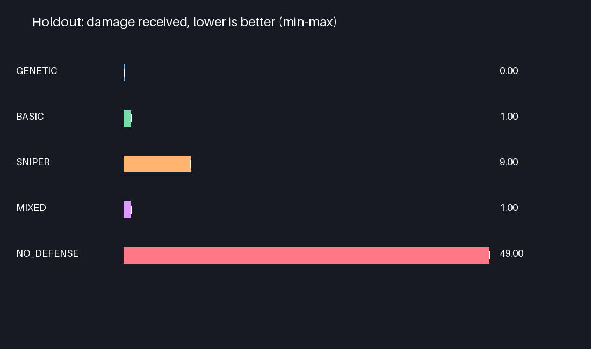
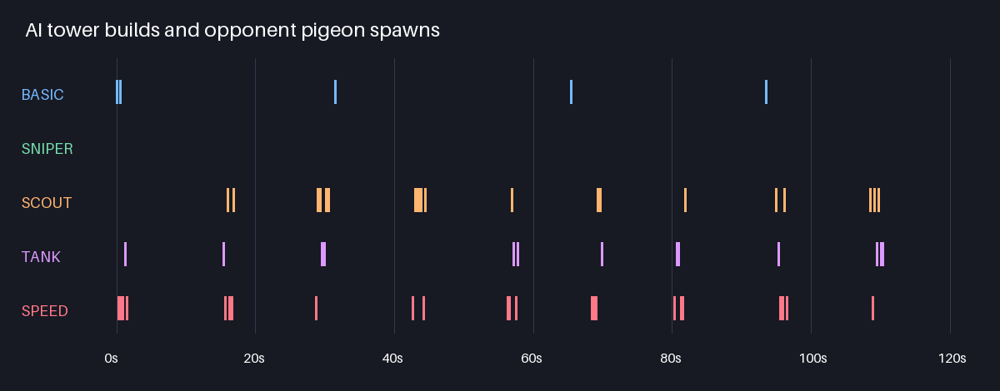
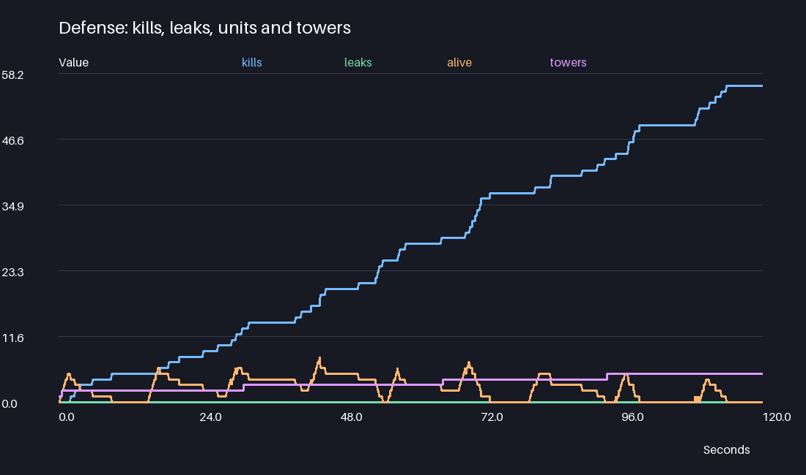
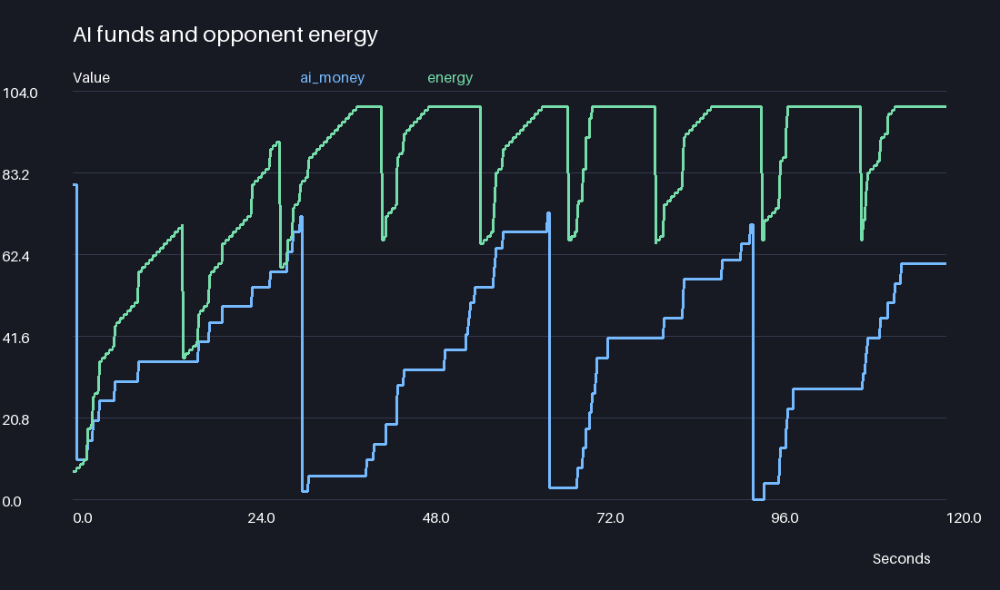
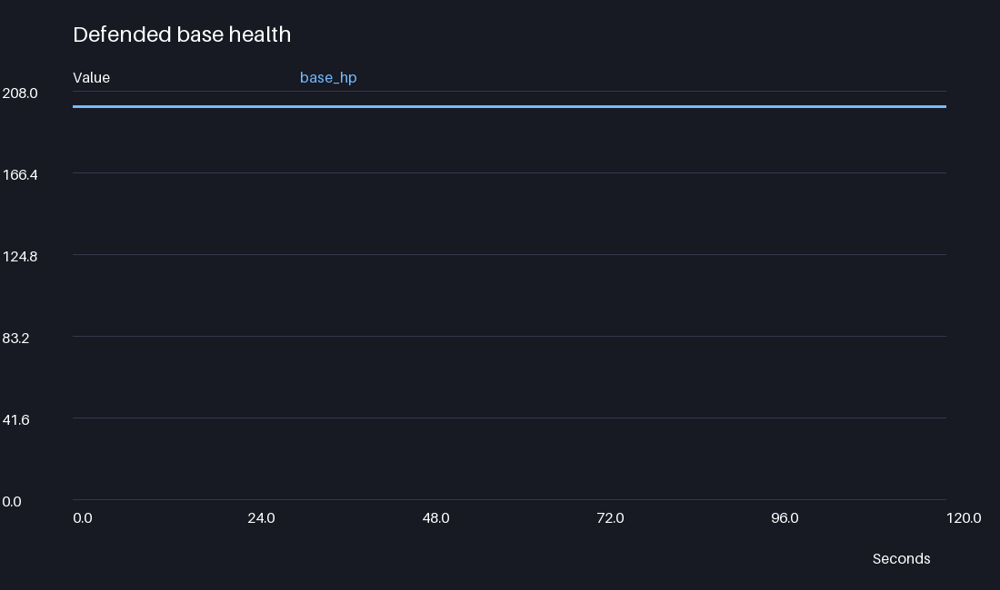
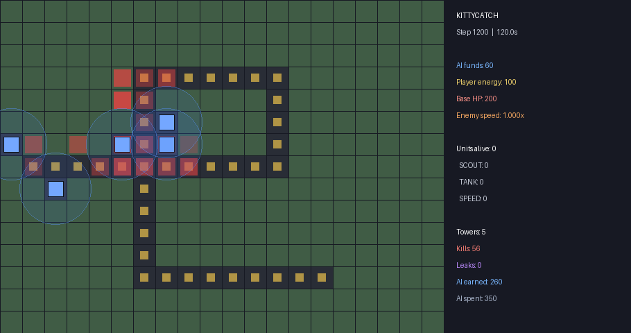

# Sprawozdanie: nowe układy obrony KittyCatch

## Role i cel eksperymentu

**AI broni bazy: wybiera typ, miejsce i czas budowy wież. Gołębie wysyła przeciwnik.** Jedyną akcją modelu jest `build_tower`, zgodna z istniejącym socketem Godota. Badanie dotyczy limitu energii 100, bazy 200 HP i epizodów długości 120 s.

Cel: minimalizacja obrażeń otrzymanych przez bazę. Fitness = −liczba przecieków + 0,1 × zabite / max(faktycznie wysłane gołębie, 1). Wyższy fitness jest lepszy; na wykresie porównawczym niższe obrażenia są lepsze. Premia za zabicia rozstrzyga remisy. Podstawowym kryterium selekcji jest średnia fitness po ziarnach treningowych.

## Wyniki na oddzielnych scenariuszach testowych

| Strategia obrony | Śr. obrażenia ↓ | Odchylenie | Min–maks | Śr. zabicia | Śr. wieże |
| --- | --- | --- | --- | --- | --- |
| GENETIC | 0.00 | 0.00 | 0–0 | 56.0 | 5.0 |
| BASIC | 1.00 | 0.00 | 1–1 | 54.0 | 5.0 |
| SNIPER | 9.00 | 0.00 | 9–9 | 46.0 | 3.0 |
| MIXED | 1.00 | 0.00 | 1–1 | 54.0 | 5.0 |
| NO_DEFENSE | 49.00 | 0.00 | 49–49 | 0.0 | 0.0 |

GENETIC: zwycięzca treningu. BASIC / SNIPER / MIXED: heurystyki pokrycia trasy, odpowiednio jeden typ lub typy naprzemienne; wszystkie mają tyle samo slotów budowy. NO_DEFENSE: kontrola bez wież. Chromosom nie jest wybierany na podstawie testu.

GA_z: zwycięzca niezależnego przebiegu o ziarnie z. PREVIOUS: poprzedni chromosom ponownie oceniony na aktualnym balansie i tych samych scenariuszach, z zachowaniem jego zapisanych czasów budowy. Nie mieszamy historycznych wyników uzyskanych przy innych zasadach z aktualnym testem.



## Parametry treningu

| Parametr | Wartość |
| --- | --- |
| population | 32 |
| generations | 30 |
| slots | 10 |
| duration | 120.0 |
| dt | 0.1 |
| seed | 42 |
| search_seeds | None |
| mutation_rate | 0.15 |
| train_seeds | [10, 11, 12, 13, 14] |
| test_seeds | [103] |

Selekcja turniejowa: 3 osobniki. Krzyżowanie: niezależnie każdy gen od jednego z rodziców (50/50). Mutacja: szum Gaussa σ=0,15 i obcięcie do [0,1]. Elitaryzm: max(1, populacja // 8). Populacja początkowa zawiera heurystyki pokrycia trasy. Losowe plany zaczynają od czasów w pierwszych 20% epizodu. Remisy fitness wewnątrz populacji rozstrzyga losowanie kontrolowane ziarnem przebiegu, co pozwala zachować różne równie skuteczne układy.

Identyfikator konfiguracji SHA-256: 0f863932a7a358c6dd450f3e5370c1a970d6cbfa7f7a3b2f7c0c44fb49379775.

Ten raport jest ponowną oceną zapisanej strategii; nie uruchomiono nowego treningu. Parametry populacji i pokoleń w argumentach nie opisują pochodzenia zapisanego chromosomu.

## Chromosom i jego interpretacja

Chromosom ma **40 genów**, czyli **10 slotów budowy**. Każda czwórka to `[typ, x, y, najwcześniejszy_czas]`. Kolejność typów: BASIC, SNIPER. Slot nie jest gwarancją zbudowania wieży: potrzeba środków, wolnego pola i potwierdzenia poprzedniej komendy.

Typ = min(liczba_typów − 1, int(gen × liczba_typów)). x = round(gen × (szerokość − 1)), y = round(gen × (wysokość − 1)). Najwcześniejszy czas = gen × limit epizodu. Sloty są przeglądane według czasu, potem indeksu. Jeśli wybrane pole jest niedostępne, model wybiera najbliższe aktualnie wolne pole budowy według odległości kwadratowej; remisy rozstrzyga (x,y). Nie blokuje tańszych gotowych slotów, gdy na droższy brakuje pieniędzy.

```json
{
  "tower_types": [
    "BASIC",
    "SNIPER"
  ],
  "genes": [
    0.1508147420518636,
    0.2631578947368421,
    0.5045155088648683,
    0,
    0.36362168798435346,
    0.36926471997872423,
    0.42857142857142855,
    0,
    0.46725195683378495,
    0.3684210526315789,
    0.7857142857142857,
    0.20018840516293976,
    0.47998399441696404,
    0.3684210526315789,
    0.3612975114837898,
    0,
    0.30748981831541816,
    0.02275253711075638,
    0.42857142857142855,
    0,
    0.15694841075070454,
    0.7653436136691596,
    0.2857142857142857,
    0.4619769418090586,
    0.2576942677196105,
    0.10526315789473684,
    0.5520606095579297,
    0,
    0,
    0.3684210526315789,
    0.7425794788074074,
    0,
    0.5492669292601929,
    0.7319512789753937,
    0.5420142912277314,
    0.1916726251043829,
    0.49437111087225516,
    0.8180419749904531,
    0.6130023735094929,
    0
  ],
  "duration": 120.0,
  "role": "tower_defense"
}
```

### Odkodowany plan budowy (przed korektą zajętych pól)

| Slot (od 0) | Indeksy genów | Typ | Cel x | Cel y | Najwcześniej [s] |
| --- | --- | --- | --- | --- | --- |
| 0 | 0–3 | BASIC | 5 | 7 | 0.000 |
| 1 | 4–7 | BASIC | 7 | 6 | 0.000 |
| 3 | 12–15 | BASIC | 7 | 5 | 0.000 |
| 4 | 16–19 | BASIC | 0 | 6 | 0.000 |
| 6 | 24–27 | BASIC | 2 | 8 | 0.000 |
| 7 | 28–31 | BASIC | 7 | 10 | 0.000 |
| 9 | 36–39 | BASIC | 16 | 9 | 0.000 |
| 8 | 32–35 | SNIPER | 14 | 8 | 23.001 |
| 2 | 8–11 | BASIC | 7 | 11 | 24.023 |
| 5 | 20–23 | BASIC | 15 | 4 | 55.437 |

## Ustawienia przeciwnika: fale gołębi

Scenariusz = ziarno + profil. Profil wybierany przez seed modulo 5: 0: SCOUT, 1: TANK, 2: SPEED, 3: MIXED, 4: BURST. SCOUT/TANK/SPEED używają jednego typu, MIXED i BURST losują skład. Budżet żądanej fali to 35 energii, a BURST 65, ograniczony maksimum energii gracza. Planowany start pierwszej fali: 0 s. Następne odstępy: losowo 11–16 s, BURST 20–26 s.

Harmonogram żądań generowany jest przed epizodem, niezależnie od chromosomu. Koszty i regeneracja obowiązują normalnie: jeśli brakuje energii lub kolejka trwa, przeciwnik czeka. Zabicia zwracają energię graczowi, więc rzeczywiste czasy i liczba wysłanych fal mogą różnić się między strategiami. Nie traktujemy takich przebiegów jako identycznych fal w identycznym czasie.

| Seed | Profil | Obrażenia ↓ | HP bazy | Zabicia | Wysłane | Wieże | Wydatek AI | Odrzucone |
| --- | --- | --- | --- | --- | --- | --- | --- | --- |
| 103 | MIXED | 0 | 200 | 56 | 56 | 5 | 350 | 0 |

## Balans gry i ekonomia

| Wieża | Koszt | Zasięg w JSON | Zasięg fizyczny [kafle] | Obrażenia | Ataki/s |
| --- | --- | --- | --- | --- | --- |
| BASIC | 70 | 2.0 | 0.80 | 19 | 1.25 |
| SNIPER | 100 | 4.5 | 1.80 | 30 | 0.25 |

| Gołąb | HP | Szybkość [kafle/s] | Koszt energii | Nagroda dla AI |
| --- | --- | --- | --- | --- |
| SCOUT | 20 | 1.0 | 4 | 4 |
| TANK | 60 | 0.8 | 5 | 5 |
| SPEED | 30 | 1.4 | 7 | 5 |

```json
{
  "economy": {
    "player": {
      "starting_energy": 40,
      "max_energy": 100,
      "energy_regen_per_second": 2.0,
      "kill_energy_refund_fraction": 1.0
    },
    "ai": {
      "starting_money": 150
    }
  },
  "combat": {
    "tower_range_scale": 0.4,
    "enemy_hit_radius_px": 8.0,
    "enemy_path_spread_px": 8.0,
    "enemy_speed_bonus_per_base_hit": 0.005,
    "max_enemy_speed_bonus": 0.1
  },
  "base": {
    "health": 200
  },
  "map": {
    "tile_size_px": 64,
    "cell_size_px": 32,
    "width_tiles": 20,
    "height_tiles": 15
  }
}
```

Zdrowie startowe bazy: 200. Każdy przeciek zadaje 1 obrażenie. Wieże finansowane są z funduszy AI oraz nagród za zabicia. Energia służy wyłącznie przeciwnikowi do wysyłania gołębi. Zwrot przy dotarciu do celu: ceil(koszt/2).

## Jedna rozgrywka zwycięskiej obrony

Seed **103**, profil **MIXED**. Wybrany jawnie lub jako pierwszy z listy testowej; nie wybieramy najlepszego testu do animacji. Czas: 120.0 s. Baza: **200 HP**, przecieki: **0**, zabicia: **56**, wieże AI: **5**.

### Faktyczne budowy wież przez AI

| Czas [s] | Slot | Typ | x | y | Koszt |
| --- | --- | --- | --- | --- | --- |
| 0.0 | 0 | BASIC | 5 | 6 | 70 |
| 0.5 | 1 | BASIC | 7 | 6 | 70 |
| 31.5 | 3 | BASIC | 7 | 5 | 70 |
| 65.5 | 4 | BASIC | 0 | 6 | 70 |
| 93.5 | 6 | BASIC | 2 | 8 | 70 |

Niewykonane sloty: 7, 9, 8, 2, 5. Mogły oczekiwać na pieniądze, najwcześniejszy czas lub wolne pole do końca epizodu.

### Fale przeciwnika: planowane i rzeczywiste czasy

| Fala | Plan [s] | Start [s] | SCOUT | TANK | SPEED | Koszt energii |
| --- | --- | --- | --- | --- | --- | --- |
| 1 | 0.0 | 0.0 | 0 | 1 | 4 | 33 |
| 2 | 15.1 | 15.1 | 2 | 1 | 3 | 34 |
| 3 | 28.4 | 28.4 | 4 | 2 | 1 | 33 |
| 4 | 42.3 | 42.4 | 5 | 0 | 2 | 34 |
| 5 | 55.9 | 56.0 | 1 | 2 | 3 | 35 |
| 6 | 68.1 | 68.1 | 2 | 1 | 3 | 34 |
| 7 | 80.1 | 80.1 | 1 | 2 | 3 | 35 |
| 8 | 94.6 | 94.7 | 2 | 1 | 3 | 34 |
| 9 | 108.3 | 108.3 | 3 | 3 | 1 | 34 |

### Bilans gołębi według typu

| Typ | Wysłane | Zabite | Dotarły do bazy | Na trasie | W kolejce |
| --- | --- | --- | --- | --- | --- |
| SCOUT | 20 | 20 | 0 | 0 | 0 |
| TANK | 13 | 13 | 0 | 0 | 0 |
| SPEED | 23 | 23 | 0 | 0 | 0 |











## Uruchomienie AI przez socket Godota

Z katalogu python_ai uruchom serwer, następnie otwórz godot_game/project.godot i uruchom grę (F6/F5 zgodnie z projektem):

```powershell
python -m src.serwer --strategy ../../wyniki/sprawdzenie_paczki/best_strategy.json --host 127.0.0.1 --port 8080
```

Godot jest klientem TCP. Python odbiera init i update, odsyła JSON UTF-8 zakończony znakiem nowej linii. Przykład akcji:

```json
{"action":"build_tower","command_id":"ga-episode-step-seq-s0","tower_type":"BASIC","x":3,"y":3}
```

Model nie wysyła fal. Kontroluje budżet i wolne pola w aktualnej obserwacji. Wysyła maksymalnie jedną komendę na 0,5 s i czeka na action_result. Powtórzone lub starsze update nie generują kolejnych komend; init nowego epizodu resetuje plan. Po 2 s bez potwierdzenia sprawdza zajętość pola i rozstrzyga, czy ponowić slot. Sam Godot ostatecznie zatwierdza koszt, typ i położenie wieży.

## Pliki, odtwarzalność i ograniczenia

- [Chromosom obrony](best_strategy.json)
- [Dane eksperymentu](report.json), [pełne przebiegi, zdarzenia i plan](detailed_report.json)
- [Budowy wszystkich testów](builds.csv), [fale przeciwnika](waves.csv), [pojawienia się gołębi](spawns.csv)
- [Porównanie](comparison.csv), [przebieg wybranej gry](replay.csv)

```powershell
python -m src.experiment_report --input ../../wyniki/sprawdzenie_paczki/report.json --gif --replay-seed 103
python -m src.pdf_report --input ../../wyniki/sprawdzenie_paczki/report.md
```

Wyniki dotyczą jednej mapy, zapisanej konfiguracji i badanych profili gołębi. Algorytm wybiera najlepszy sprawdzony plan, bez dowodu globalnego optimum. Limit slotów ogranicza liczbę wież. Wynik lokalnej symulacji nie jest wynikiem meczu w Godocie; fizyka, dyskretny krok i opóźnienia sieci mogą zmienić rezultat. Integracja socketu jest testowana protokołem; rzeczywisty mecz wymaga uruchomionego Godota.
